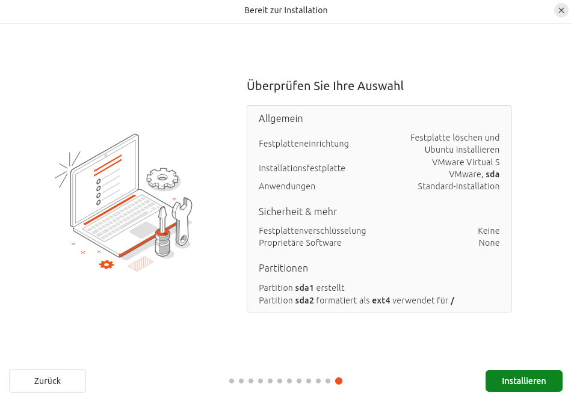
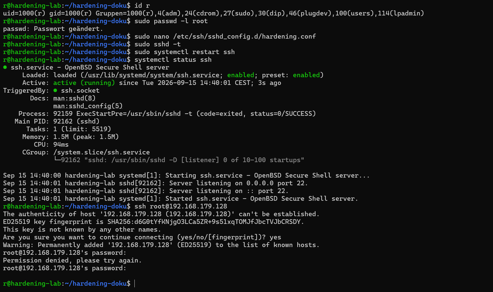
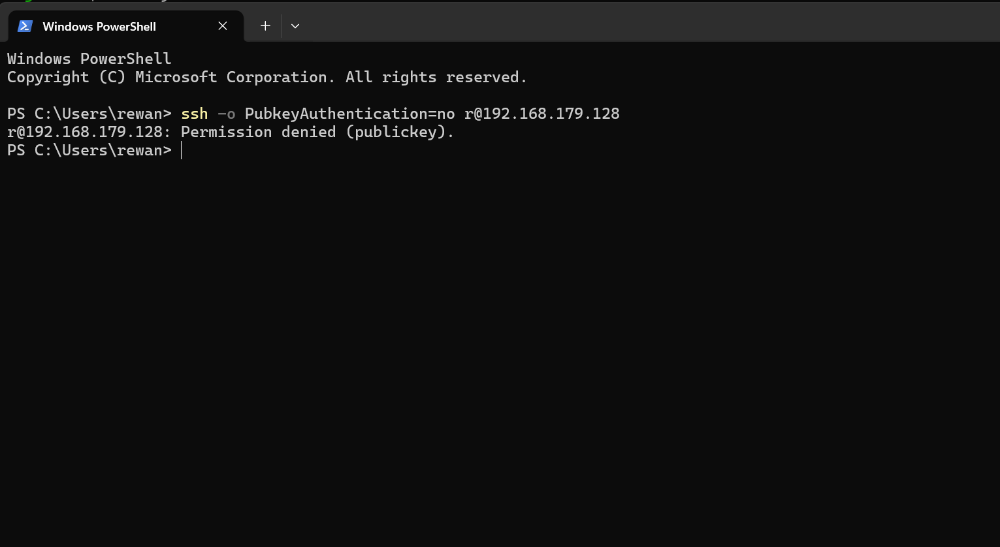

# Systemhärtung eines Ubuntu Linux-Servers

**Modul:** M182 · **Kompetenzstufe:** C1B
**Autor:** Rewan Ezzeldin
**Datum:** 15.09.2026

## 1. Ausgangslage

Testumgebung: VMware Workstation Pro, Ubuntu 24.04.2 LTS (Desktop),
4 GB RAM, 2 vCPU, 40 GB Disk, Netzwerkadapter im NAT-Modus.
Installation ohne Drittanbieter-Software und ohne Updates während
der Installation, um einen ungehärteten Vanilla-Zustand als
Ausgangspunkt zu erhalten.




markdown
### Systeminfo

```
$ hostnamectl
Static hostname: hardening-lab
Operating System: Ubuntu 24.04.2 LTS
Kernel: Linux 6.7.0-31-generic
Virtualization: vmware
```


```
$ sudo systemctl enable --now ssh
$ systemctl status ssh
● ssh.service - OpenBSD Secure Shell server
     Active: active (running) since Tue 2026-09-15 11:51:47 CEST
     ...
Sep 15 11:51:47 hardening-lab sshd[5690]: Server listening on 0.0.0.0 port 22.
Sep 15 11:51:47 hardening-lab sshd[5690]: Server listening on :: port 22.
```


## 2. IST-Zustand vor der Härtung

### 2.1 Offene Ports & Dienste

```
$ sudo ss -tulnp
udp   UNCONN 0 0    0.0.0.0:5353   0.0.0.0:*  users:(("avahi-daemon",pid=1126))
udp   UNCONN 0 0       [::]:5353      [::]:*  users:(("avahi-daemon",pid=1126))
tcp   LISTEN 0 4096  0.0.0.0:22    0.0.0.0:*  users:(("sshd",pid=5690))
tcp   LISTEN 0 4096     [::]:22       [::]:*  users:(("sshd",pid=5690))
tcp   LISTEN 0 4096 127.0.0.1:631  0.0.0.0:*  users:(("cupsd",pid=1399))
```

Lokal gebunden (nicht von aussen erreichbar): DNS-Stub-Resolver (127.0.0.53/.54:53),
CUPS (127.0.0.1:631 / [::1]:631). Nach aussen offen: SSH (Port 22, IPv4 + IPv6,
gewollt) sowie Avahi/mDNS (Port 5353 + dynamische Ports, IPv4 + IPv6) — ein
Netzwerk-Discovery-Dienst ohne Nutzen auf diesem System.

### 2.2 Laufende Prozesse

Das System hatte zum Analysezeitpunkt 361 laufende Prozesse (`ps aux | wc -l`).
Auffällig: Bluetooth-, CUPS- und Avahi-Dienste laufen dauerhaft, obwohl die
VM weder Bluetooth-Hardware noch einen Drucker hat und keine Netzwerk-
Discovery benötigt.

```
$ ps aux | grep -E 'bluetooth|cups|avahi|snapd'
avahi       1126  ...  avahi-daemon: running [hardening-lab.local]
root        1127  ...  /usr/libexec/bluetooth/bluetoothd
root        1145  ...  /usr/lib/snapd/snapd
root        1399  ...  /usr/sbin/cupsd -l
cups-br+    1760  ...  /usr/sbin/cups-browsed
```

### 2.3 Benutzerkonten & Sudo-Rechte

Nur zwei Konten mit echter Login-Shell: `root` (UID 0) und `r` (UID 1000).
Alle Systemkonten sind mit `/usr/sbin/nologin` bzw. `/bin/false` gegen
direkten Login gesperrt.

```
$ grep -Po '^sudo.+:\K.*' /etc/group
r
```

Einziges Mitglied der sudo-Gruppe ist der angelegte Benutzer `r`.

### 2.4 Erkannte Risiken

1. SSH erlaubt Root-Login und Passwort-Authentifizierung — noch nicht eingeschränkt.
2. Keine Firewall aktiv — alle offenen Ports sind ungefiltert erreichbar.
3. Avahi/mDNS lauscht auf allen Interfaces (0.0.0.0:5353), obwohl kein
   Bedarf an Netzwerk-Autodiscovery besteht — unnötige Angriffsfläche.
4. Bluetooth-Dienst aktiv, obwohl die VM über keine entsprechende Hardware
   verfügt — läuft mit Root-Rechten ohne jeden Nutzen.
5. IPv6 ist aktiv und exponiert dieselben Dienste wie IPv4 (SSH, Avahi),
   wird aber im NAT-Netz der VM nicht benötigt.

   ### 2.5 Lynis-Sicherheitsaudit (Baseline)

```
$ sudo lynis audit system
Hardening index : 59 [###########         ]
Tests performed : 252
Plugins enabled : 1
```

Der initiale Hardening Index liegt bei 59 von 100. Lynis meldet eine Firewall-
Komponente als erkannt, obwohl noch keine aktive Filterregel konfiguriert ist —
dies wird in Schritt 3 (Erfolgskontrolle) mit dem Nachher-Wert verglichen.

## 3. Durchgeführte Härtungsmassnahmen

### 3.1 Massnahme 1: Systemaktualisierung

**Was bewirkt diese Massnahme technisch?**
Alle installierten Pakete werden auf den neuesten verfügbaren Sicherheits-
und Funktionsstand gebracht. `apt dist-upgrade` löst dabei auch geänderte
Paketabhängigkeiten korrekt auf, nicht nur einfache Versionsanhebungen.
Zusätzlich werden mit `apt autoremove` nicht mehr benötigte, automatisch
installierte Pakete entfernt, um die installierte Softwaremenge und damit
die Angriffsfläche zu reduzieren.

**Vor welchem Angriffsszenario schützt sie?**
Viele Angriffe nutzen bekannte, bereits gepatchte Schwachstellen in
veralteter Software aus (z. B. über öffentlich dokumentierte CVEs).
Ein aktuelles System schliesst diese Lücken, bevor sie ausgenutzt werden
können.

**Prüfbefehl:**
```
$ sudo apt update
Aktualisierung für 5 Pakete verfügbar.
```

Die verbleibenden 5 Pakete (netplan-Komponenten, power-profiles-daemon)
sind durch Ubuntus "Phased Updates"-Mechanismus bewusst zurückgehalten:
Ubuntu rollt Updates mit Risikopotenzial (hier: Netzwerkkonfiguration)
schrittweise über mehrere Tage aus, um Probleme frühzeitig zu erkennen,
bevor sie alle Systeme erreichen. Kein Fehlerzustand, sondern beabsichtigtes
Verhalten.

```
$ sudo apt autoremove -y
Die folgenden Pakete werden ENTFERNT:
  libfwupd2 libgl1-amber-dri libglapi-amber libwoff1
0 aktualisiert, 0 neu installiert, 4 zu entfernen und 5 nicht aktualisiert.
Nach dieser Operation werden 16,7 MB Plattenplatz freigegeben.
```

### 3.2 Massnahme 2: Neuen Administrator anlegen

**Was bewirkt diese Massnahme technisch?**
Statt direkt als `root` zu arbeiten, wird ein personalisierter Benutzer mit
`sudo`-Rechten verwendet. Zusätzlich wird das Passwort des `root`-Kontos
gesperrt (`passwd -l`), sodass ein direkter Login oder `su` mit Passwort
nicht mehr möglich ist. Administrative Befehle laufen weiterhin über `sudo`,
jede Aktion bleibt dabei einem konkreten Benutzer zuordenbar.

**Vor welchem Angriffsszenario schützt sie?**
Ohne personalisierte Konten lässt sich bei mehreren Administratoren nicht
nachvollziehen, wer welche Änderung vorgenommen hat. Ein gesperrtes
root-Passwort verhindert ausserdem Brute-Force- oder Rateversuche direkt
gegen das mächtigste Konto des Systems — Angreifer müssten zusätzlich an
das Passwort eines regulären, sudo-berechtigten Benutzers gelangen.

**Prüfbefehl:**
```
$ id r
uid=1000(r) gid=1000(r) Gruppen=1000(r),4(adm),24(cdrom),27(sudo),30(dip),46(plugdev),100(users),114(lpadmin)

$ sudo passwd -l root
passwd: Passwort geändert.
```

Die Gruppenzugehörigkeit `27(sudo)` bestätigt die Administratorrechte des
Benutzers `r`. Ein anschliessender Versuch `su -` mit root-Passwort würde
fehlschlagen, da dessen Passwort gesperrt ist.

### 3.3 Massnahme 3: SSH-Root-Login verbieten

**Was bewirkt diese Massnahme technisch?**
In `/etc/ssh/sshd_config.d/hardening.conf` wird `PermitRootLogin no` gesetzt.
Damit weist sshd jeden Verbindungsversuch mit dem Benutzernamen `root`
zurück, unabhängig davon, ob ein korrektes Passwort oder ein gültiger
SSH-Key vorliegt.

**Vor welchem Angriffsszenario schützt sie?**
Das Root-Konto ist auf jedem Linux-System vorhanden und sein Benutzername
ist immer bekannt — Angreifer müssen ihn nicht erst erraten. Automatisierte
Brute-Force-Angriffe zielen deshalb sehr häufig direkt auf `root`. Ist der
Login für dieses Konto komplett gesperrt, läuft ein solcher Angriff ins
Leere, selbst wenn das root-Passwort erraten würde.

**Prüfbefehl:**
```
$ sudo sshd -t
$ sudo systemctl restart ssh
$ systemctl status ssh
Active: active (running)
```

Nachweis durch einen Verbindungsversuch als root:

```
$ ssh root@192.168.179.128
root@192.168.179.128's password:
Permission denied, please try again.
```



### 3.4 Massnahme 4: SSH-Passwort-Login deaktivieren

**Was bewirkt diese Massnahme technisch?**
In `/etc/ssh/sshd_config.d/hardening.conf` wird zusätzlich
`PasswordAuthentication no` gesetzt. Damit akzeptiert sshd ausschliesslich
noch Anmeldungen über einen hinterlegten SSH-Key (Public-Key-Authentifizierung)
und lehnt jeden Versuch mit Benutzername/Passwort direkt ab, ohne überhaupt
ein Passwort abzufragen.

Voraussetzung war, dass zuvor ein SSH-Schlüsselpaar erzeugt (`ssh-keygen`)
und der öffentliche Schlüssel in `~/.ssh/authorized_keys` des Benutzers `r`
hinterlegt wurde.

**Vor welchem Angriffsszenario schützt sie?**
Passwörter lassen sich erraten, per Brute-Force ausprobieren oder durch
Phishing/Leaks kompromittieren. Ein privater SSH-Key ist praktisch nicht
zu erraten und verlässt niemals den Client-Rechner. Selbst wenn ein
Angreifer den Benutzernamen kennt, kommt er ohne den passenden privaten
Schlüssel nicht mehr ins System.

**Prüfbefehl:**
```
$ cat /etc/ssh/sshd_config.d/hardening.conf
PermitRootLogin no
PasswordAuthentication no

$ sudo sshd -t
$ sudo systemctl restart ssh
$ systemctl status ssh
Active: active (running)
```

Login mit hinterlegtem SSH-Key funktioniert weiterhin ohne Passwortabfrage.
Ein erzwungener Versuch, stattdessen Passwort-Authentifizierung zu nutzen,
wird sofort verweigert:

```
$ ssh -o PubkeyAuthentication=no r@192.168.179.128
r@192.168.179.128: Permission denied (publickey).
```



### 3.5 Massnahme 5: Firewall (UFW) konfigurieren

**Was bewirkt diese Massnahme technisch?**
Die Uncomplicated Firewall (UFW) wird aktiviert und so konfiguriert, dass
eingehende Verbindungen standardmässig blockiert werden (`default deny
incoming`), mit einer expliziten Ausnahme für SSH (Port 22, sowohl IPv4
als auch IPv6). Ausgehende Verbindungen bleiben uneingeschränkt erlaubt.

**Vor welchem Angriffsszenario schützt sie?**
Ohne Firewall ist jeder offene Port direkt aus dem Netz erreichbar,
einschliesslich Diensten, die eigentlich nur lokal gedacht waren oder aus
Versehen nach aussen lauschen (siehe Avahi/mDNS im IST-Zustand). Eine
Default-Deny-Firewall reduziert die Angriffsfläche auf exakt die Dienste,
die bewusst freigegeben wurden — selbst wenn künftig versehentlich ein
weiterer Dienst einen Port öffnet, bleibt er von aussen unerreichbar.

**Prüfbefehl:**
```
$ sudo ufw status verbose
Status: Aktiv
Voreinstellung: deny (eingehend), allow (abgehend), disabled (gesendet)

Zu                         Aktion      Von
--                         ------      ---
22/tcp                     ALLOW IN    Anywhere
22/tcp (v6)                ALLOW IN    Anywhere (v6)
```

Die Firewall ist aktiv, folgt dem Prinzip minimaler Rechtevergabe (nur SSH
freigegeben) und startet automatisch beim Systemstart.

### 3.6 Massnahme 6: IPv6 deaktivieren

**Was bewirkt diese Massnahme technisch?**
In `/etc/sysctl.d/99-disable-ipv6.conf` werden die Kernel-Parameter
`net.ipv6.conf.all.disable_ipv6` und `net.ipv6.conf.default.disable_ipv6`
auf `1` gesetzt. Damit werden allen Netzwerkschnittstellen keine
IPv6-Adressen mehr zugewiesen.

**Vor welchem Angriffsszenario schützt sie?**
Läuft IPv6 unbeachtet parallel zu IPv4, überwacht eine Firewall-Konfiguration,
die nur auf IPv4 ausgelegt ist, den zweiten Stack oft nicht mit — Dienste
könnten über IPv6 erreichbar sein, ohne dass es auffällt (siehe SSH und
Avahi im IST-Zustand, beide auf `[::]` erreichbar). Da dieses System kein
IPv6 benötigt, wird der komplette Protokoll-Stack deaktiviert, statt ihn
nur zu filtern.

**Prüfbefehl:**
```
$ ip -6 addr show
[keine Ausgabe – keine IPv6-Adressen mehr zugewiesen]
```

Hinweis: Bereits laufende Dienste (z. B. `sshd`) können bis zu einem
vollständigen Systemneustart noch einen IPv6-Wildcard-Socket (`[::]`)
offen zeigen, sind über diesen aber ohne zugewiesene IPv6-Adresse nicht
mehr erreichbar. Der endgültige Nachweis erfolgt nach dem Neustart in
Abschnitt 4 (Erfolgskontrolle).

### 3.7 Massnahme 7: Unnötige Dienste entfernen

**Was bewirkt diese Massnahme technisch?**
Dienste ohne Funktion auf diesem System werden deaktiviert und vollständig
deinstalliert: Avahi (Netzwerk-Autodiscovery), CUPS samt cups-browsed
(Drucksystem) und Bluetooth (bluez), da die VM über keine entsprechende
Hardware verfügt bzw. keinen Bedarf an Netzwerk-Discovery hat. Zusätzlich
wurde geprüft, ob die im Auftrag genannten Alt-Tools (`net-tools`,
`rsh-client`, `talk`) vorhanden sind.

**Vor welchem Angriffsszenario schützt sie?**
Jeder installierte und laufende Dienst ist potenzielle Angriffsfläche —
unabhängig davon, ob er genutzt wird. Ungenutzte, aber aktive Netzwerk-
dienste (wie Avahi auf Port 5353) können für Reconnaissance oder als
Einfallstor für dienstspezifische Schwachstellen missbraucht werden.
Wird ein Dienst komplett entfernt statt nur gestoppt, kann er auch nicht
versehentlich (z. B. durch ein Update) wieder aktiviert werden.

**Prüfbefehl:**
```
$ sudo ss -tulnp
udp   UNCONN 0 4096   127.0.0.54:53   0.0.0.0:*  systemd-resolve
tcp   LISTEN 0 4096     0.0.0.0:22    0.0.0.0:*  sshd
tcp   LISTEN 0 4096        [::]:22       [::]:*  sshd

$ systemctl status avahi-daemon
Unit avahi-daemon.service could not be found.
```

Avahi, CUPS und Bluetooth sind vollständig deinstalliert; die zugehörigen
Ports (5353, 631) sind aus der Liste verschwunden. Es sind nur noch der
lokale DNS-Stub-Resolver (nicht von aussen erreichbar) und SSH aktiv.

Die Pakete `net-tools`, `rsh-client` und `talk` waren auf dieser Ubuntu-
24.04-Installation von vornherein nicht installiert — keine Aktion nötig.

## 4. Erfolgskontrolle & Verifikation

### 4.1 Offene Ports & Dienste (Vorher/Nachher)

**Vorher:**
```
$ sudo ss -tulnp
udp  0.0.0.0:5353    avahi-daemon
udp  [::]:5353       avahi-daemon
tcp  0.0.0.0:22      sshd
tcp  [::]:22         sshd
tcp  127.0.0.1:631   cupsd
tcp  [::1]:631       cupsd
```

**Nachher:**
```
$ sudo ss -tulnp
udp   127.0.0.54:53      systemd-resolve
udp   127.0.0.53%lo:53   systemd-resolve
tcp   0.0.0.0:22         sshd
tcp   127.0.0.53%lo:53   systemd-resolve
tcp   127.0.0.54:53      systemd-resolve
```

Avahi (Port 5353) und CUPS (Port 631) sind vollständig verschwunden, da
die zugehörigen Dienste deinstalliert wurden. SSH ist nur noch über IPv4
erreichbar, kein IPv6-Listener mehr vorhanden (siehe Zusatzbefund unten).
Übrig bleibt ausschliesslich SSH sowie der lokale, nicht von aussen
erreichbare DNS-Stub-Resolver.

### 4.2 Firewall

**Vorher:** keine Firewall aktiv, alle offenen Ports ungefiltert erreichbar.

**Nachher:**
```
$ sudo ufw status verbose
Status: Aktiv
Voreinstellung: deny (eingehend), allow (abgehend), disabled (gesendet)

Zu                         Aktion      Von
--                         ------      ---
22/tcp                     ALLOW IN    Anywhere
22/tcp (v6)                ALLOW IN    Anywhere (v6)
```

Nur noch SSH ist von aussen erreichbar, alle anderen eingehenden
Verbindungen werden standardmässig verworfen.

### 4.3 IPv6

**Vorher:** IPv6 aktiv, SSH und Avahi über `[::]` erreichbar.

**Nachher:**
```
$ ip -6 addr show
[keine Ausgabe]
```

Keiner Netzwerkschnittstelle ist noch eine IPv6-Adresse zugewiesen.

**Zusatzbefund:** Die sysctl-Einstellung `disable_ipv6` verhindert die
Zuweisung von IPv6-Adressen, verhindert aber nicht, dass Dienste einen
IPv6-Wildcard-Socket öffnen. Bei SSH lag der Grund tiefer: Ubuntu 24.04
aktiviert `sshd` nicht direkt, sondern über die systemd-Einheit
`ssh.socket`, welche eine eigene, von `sshd_config` unabhängige
Listen-Konfiguration besitzt (`AddressFamily inet` in der sshd-Config griff
deshalb nicht). Erst ein systemd-Override für `ssh.socket`
(`ListenStream=` geleert, dann neu auf `0.0.0.0:22` gesetzt) entfernte den
IPv6-Listener endgültig:

```
$ sudo systemctl edit ssh.socket
[Socket]
ListenStream=
ListenStream=0.0.0.0:22

$ sudo systemctl daemon-reload
$ sudo systemctl restart ssh.socket
$ sudo ss -tulnp
tcp   LISTEN 0 4096   0.0.0.0:22   0.0.0.0:*   sshd
```

### 4.4 Lynis Hardening Index

| | Hardening Index |
|---|---|
| Vor der Härtung | 59 |
| Nach der Härtung | 65 |

```
$ sudo lynis audit system
Hardening index : 65 [#############       ]
Tests performed : 249
```

Der Hardening Index verbesserte sich um 6 Punkte. Die Anzahl durchgeführter
Tests sank leicht von 252 auf 249, da einige geprüfte Komponenten (Avahi,
CUPS, Bluetooth) durch deren Entfernung entfallen sind.

## 5. Reflexionsfragen

### 1. Warum sollte die Härtung eines Systems idealerweise vor dem Produktivstart (Go-Live) im Netzwerk stattfinden?

Zwischen dem Zeitpunkt, an dem ein System im Netz erreichbar wird, und dem
Zeitpunkt, an dem es vollständig gehärtet ist, entsteht ein Zeitfenster,
in dem das System ungeschützt angreifbar ist — jede Minute in diesem
Fenster ist ein potenzielles Einfallstor. Zusätzlich sind Härtungsmassnahmen
an einem bereits produktiven System deutlich riskanter umzusetzen: Eine
Firewall-Regel, die versehentlich einen benötigten Port sperrt, oder ein
SSH-Neustart zur falschen Zeit, kann laufende Dienste unterbrechen und
echte Nutzer betreffen. Wird stattdessen vor dem Go-Live gehärtet, lassen
sich Fehler in einer risikofreien Umgebung entdecken und korrigieren,
bevor ein System für andere sichtbar oder erreichbar ist.

### 2. Sie haben den SSH-Root-Login deaktiviert. Wie melden Sie sich nun an, wenn Sie administrative Aufgaben erledigen müssen? Warum ist dieser Zwischenschritt sicherer?

Die Anmeldung erfolgt über den personalisierten Benutzer `r` (per
SSH-Key statt Passwort), administrative Befehle werden anschliessend
einzeln mit `sudo` ausgeführt. Das ist sicherer als ein direkter
Root-Login oder ein Wechsel via `su`, weil `sudo` jeden einzelnen
Befehl protokolliert und einem konkreten Benutzer zuordnet, statt eine
komplette, anonym wirkende Root-Sitzung zu öffnen. Damit bleibt
nachvollziehbar, wer wann welche administrative Aktion durchgeführt hat
— ein direkter Root-Login würde diese Zuordenbarkeit vollständig
aufheben.

### 3. Welche Gefahren entstehen, wenn man ungenutzte IPv6-Schnittstellen oder ungenutzte offene Ports einfach ignoriert?

Dienste können über einen Kanal erreichbar bleiben, der im normalen
Monitoring oder in der Firewall-Konfiguration schlicht übersehen wird.
Genau das war in diesem Auftrag zu beobachten: SSH und Avahi liefen
sowohl über IPv4 als auch über IPv6, obwohl die Firewall-Regeln und der
erste Blick auf den IST-Zustand primär auf IPv4 fokussiert waren. Ein
Angreifer, der gezielt nach IPv6-Erreichbarkeit sucht, könnte einen
Dienst antreffen, den ein Administrator als "eigentlich abgesichert"
einstuft, weil er nur den IPv4-Pfad geprüft hat. Ungenutzte Schnittstellen
und Ports sollten deshalb nicht ignoriert, sondern aktiv deaktiviert oder
zumindest explizit in die Sicherheitsprüfung einbezogen werden.
