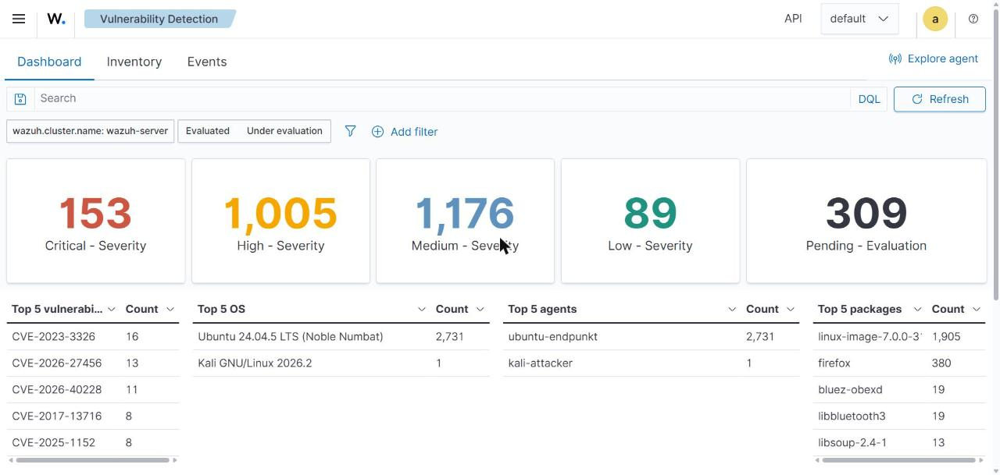
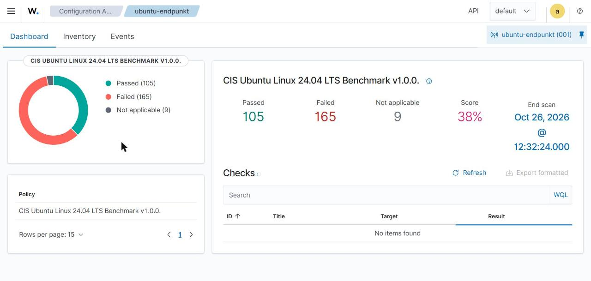

# 3. Auswertung und Wirksamkeit

Hier werden die Ergebnisse der Angriffe gesammelt und bewertet (Handlungsziel 5 und 6). Die Tabellen mit
`[AUSFÜLLEN]` während der praktischen Durchführung mit euren echten Werten und Screenshots ergänzen.

## 3.1 Überblick der erkannten Angriffe

| Szenario | Angriff | Wichtigste Regel(n) | Erkannt? | Active Response? | Zeit bis Alert |
|---|---|---|---|---|---|
| 1 | SSH-Brute-Force | 5760, 100100, 5763 | [AUSFÜLLEN] | [AUSFÜLLEN] | [AUSFÜLLEN] |
| 2 | Portscan | 100110, 100111 | [AUSFÜLLEN] | [AUSFÜLLEN] | [AUSFÜLLEN] |
| 3 | Dateimanipulation | 100120, 100121, 100122 | [AUSFÜLLEN] | – (keine AR) | [AUSFÜLLEN] |

## 3.2 Detailauswertung je Szenario

### Szenario 1 – SSH-Brute-Force

- Anzahl Fehlversuche bis zum Alert 100100: [AUSFÜLLEN]
- Wurde Kali gesperrt? Dauer der Sperre: [AUSFÜLLEN]
- Screenshot: `screenshots/vm3_bruteforce_alerts.png`
- Bewertung: [AUSFÜLLEN – z. B. „Erkennung zuverlässig, Sperre nach ca. X s“]

### Szenario 2 – Portscan

- Anzahl Alerts 100110 / ein Sammel-Alert 100111? [AUSFÜLLEN]
- Erkannt bei `-sT` und `-sS`? [AUSFÜLLEN]
- Grenzen: Ein sehr langsamer Scan (`nmap -T1`, ein Port alle paar Sekunden) unterschreitet die Schwelle
  (15 Ports in 20 s) und wird **nicht** als Portscan erkannt. [AUSFÜLLEN – getestet?]

### Szenario 3 – Dateimanipulation (FIM)

- Welche Änderungen wurden erkannt? [AUSFÜLLEN]
- Hat `whodata` den verursachenden Benutzer angezeigt? [AUSFÜLLEN]
- Verzögerung: realtime/whodata meldet sofort; ohne realtime erst beim nächsten Scan. [AUSFÜLLEN]

## 3.3 Schwachstellen- und Konfigurationsanalyse

| Modul | Ergebnis (Beispiel) | Unser Ergebnis |
|---|---|---|
| Vulnerability Detection (ubuntu-endpunkt) | Anzahl CVEs nach Schweregrad | Critical 153, High 1005, Medium 1176, Low 89 |
| SCA / CIS-Benchmark (ubuntu-endpunkt) | Score in %, Anzahl Failed Checks | Score **38 %** – Passed 105, Failed 165, n/a 9 |
| Wichtigste fehlgeschlagene SCA-Checks | z. B. „SSH PermitRootLogin“, „Passwort-Policy“ | CIS Ubuntu 24.04 LTS Benchmark v1.0.0 |

## 3.4 False Positives / False Negatives

| Typ | Beobachtung | Massnahme |
|---|---|---|
| False Positive | [AUSFÜLLEN – z. B. legitime Logins als verdächtig?] | [AUSFÜLLEN] |
| False Negative | [AUSFÜLLEN – z. B. langsamer Scan nicht erkannt] | Schwellenwert/Regel anpassen |

## 3.5 Grenzen des HIDS (wichtig für die Bewertung)

- **Verschlüsselter / langsamer Angriff:** Ein sehr langsamer Brute-Force oder Portscan unterläuft die
  Frequenzregeln. Ein NIDS würde hier zusätzlich helfen.
- **HIDS braucht Logs:** Was nicht geloggt wird, wird nicht erkannt (deshalb das iptables-Logging für den Portscan).
- **Angreifer mit Root-Rechten** kann Agent, Logs oder iptables-Regeln manipulieren. Gegenmassnahme: Logs sofort
  zentral an den Manager senden, Agent härten.
- **Active Response** sperrt nur die Quell-IP. Bei gewechselter IP oder Spoofing (bei TCP schwierig) wirkungslos.
- **Zeitsynchronisation:** Weichen die Uhren ab, passen Zeitstempel und Frequenzfenster nicht.

## 3.6 Verbesserungsvorschläge

- Zusätzlich **fail2ban** oder nur **SSH-Key-Login** → Brute-Force von vornherein verhindern.
- **NIDS (Suricata)** ergänzen → langsame Scans und Netzwerkangriffe besser erkennen (Wazuh kann Suricata-Logs
  einlesen).
- Regeln verfeinern (weitere kritische Pfade, eigene Decoder).
- E-Mail-/Slack-Benachrichtigung bei Alerts ab Level 12 einrichten.
- Längere Testreihen, um Schwellenwerte (Frequenz/Timeframe) zu optimieren.
