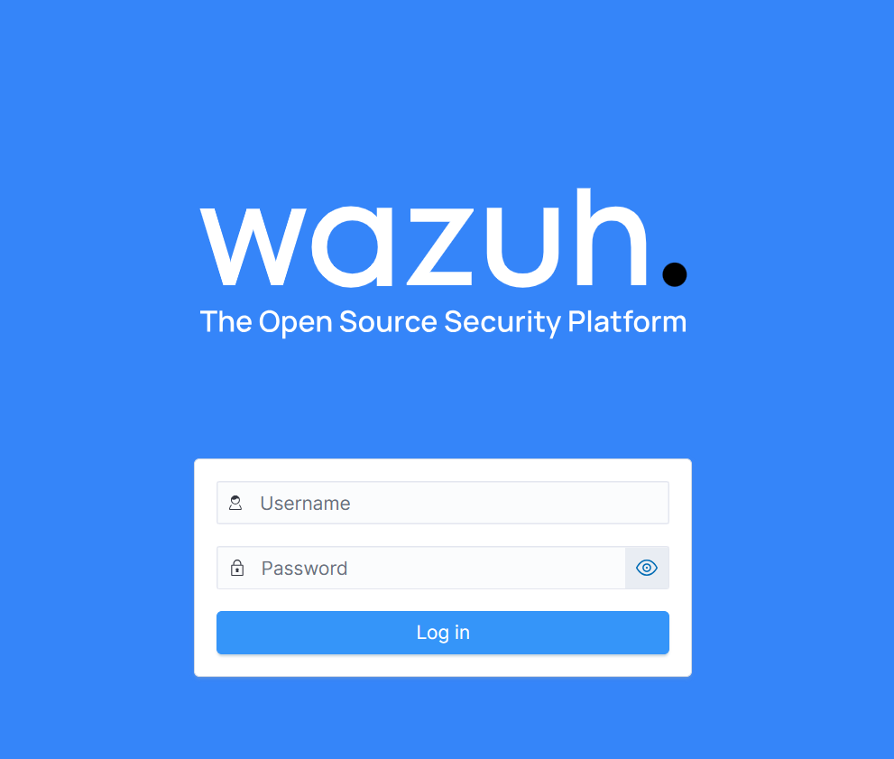

# VM1 – Installation des Wazuh-Servers

Wir installieren alle drei Server-Komponenten (Manager, Indexer, Dashboard) auf einer VM mit dem offiziellen
**Installations-Assistenten** (All-in-One-Installation).

## 1. Voraussetzungen

- Ubuntu Server 24.04 LTS frisch installiert, OpenSSH-Server aktiviert
- Statische IP `192.168.56.10` (siehe [02_Testumgebung_Netzwerkplan.md](../02_Testumgebung_Netzwerkplan.md))
- Internetzugang (NAT-Adapter)
- Mindestens 4 GB RAM (empfohlen 8 GB), 50 GB Speicher

## 2. System aktualisieren

```bash
sudo apt update && sudo apt full-upgrade -y
sudo apt install -y curl tar
sudo hostnamectl set-hostname wazuh-server
sudo timedatectl set-timezone Europe/Zurich
sudo reboot
```

> **Wichtig:** Die Uhrzeit aller VMs muss übereinstimmen, sonst passen die Zeitstempel der Alerts nicht.
> Prüfen mit `timedatectl`.

## 3. Wazuh All-in-One installieren

> Die Versionsnummer in der URL (`4.12`) durch die aktuelle Version ersetzen.
> Aktuelle Version: <https://documentation.wazuh.com/current/quickstart.html>

```bash
curl -sO https://packages.wazuh.com/4.12/wazuh-install.sh
sudo bash ./wazuh-install.sh -a
```

- `-a` = all-in-one: installiert Indexer, Manager (inkl. Filebeat) und Dashboard
- Die Installation dauert ca. 5–15 Minuten

Am Ende erscheint eine Ausgabe wie:

```text
INFO: --- Summary ---
INFO: You can access the web interface https://<wazuh-dashboard-ip>:443
    User: admin
    Password: <ADMIN_PASSWORT>
INFO: Installation finished.
```

**Das Passwort sofort sicher notieren** (z. B. im Passwortmanager). Alle Passwörter stehen auch in
`wazuh-install-files.tar`:

```bash
sudo tar -O -xvf wazuh-install-files.tar wazuh-install-files/wazuh-passwords.txt
```

## 4. Dienste prüfen

```bash
sudo systemctl status wazuh-manager
sudo systemctl status wazuh-indexer
sudo systemctl status wazuh-dashboard
sudo systemctl status filebeat
```

Alle Dienste müssen `active (running)` anzeigen.

Offene Ports prüfen:

```bash
sudo ss -tlnp | grep -E '1514|1515|55000|9200|443'
```

## 5. Firewall (optional, empfohlen)

Wenn `ufw` verwendet wird:

```bash
sudo ufw allow 22/tcp
sudo ufw allow 443/tcp
sudo ufw allow 1514/tcp
sudo ufw allow 1515/tcp
sudo ufw allow 55000/tcp
sudo ufw enable
sudo ufw status
```

## 6. Erster Login im Dashboard

1. Im Browser des Host-PCs öffnen: `https://192.168.56.10`
2. Zertifikatswarnung akzeptieren (selbstsigniertes Zertifikat)
3. Login mit `admin` und dem Passwort aus Schritt 3



## 7. Automatische Updates von Wazuh verhindern

Damit `apt upgrade` Wazuh nicht ungewollt auf eine inkompatible Version hebt:

```bash
sudo sed -i "s/^deb /#deb /" /etc/apt/sources.list.d/wazuh.list
sudo apt update
```

## 8. Agents anbinden

Die Agents werden auf VM2 und VM3 installiert:

- [VM2 – Agent installieren](../VM2_Ubuntu-Ziel/02_Installation_Wazuh-Agent.md)
- [VM3 – Agent installieren](../VM3_Kali-Angreifer/02_Installation_Wazuh-Agent.md)

Danach auf dem Server kontrollieren:

```bash
sudo /var/ossec/bin/agent_control -l
```

Erwartete Ausgabe (Beispiel):

```text
Wazuh agent_control. List of available agents:
   ID: 000, Name: wazuh-server (server), IP: 127.0.0.1, Active/Local
   ID: 001, Name: ubuntu-target, IP: any, Active
   ID: 002, Name: kali-attacker, IP: any, Active
```

Im Dashboard: **Agents management → Summary** → beide Agents müssen **active** sein.


## 9. Vulnerability Detection und SCA prüfen

Beide Module sind ab Wazuh 4.8 standardmässig aktiv. Prüfen in `/var/ossec/etc/ossec.conf`:

```xml
<vulnerability-detection>
  <enabled>yes</enabled>
  <index-status>yes</index-status>
  <feed-update-interval>60m</feed-update-interval>
</vulnerability-detection>
```

Ergebnisse im Dashboard:

- **Vulnerability Detection** → Agent `ubuntu-target` auswählen → Liste der CVEs
- **Configuration Assessment** → Agent auswählen → CIS-Benchmark für Ubuntu (bestandene / fehlgeschlagene Checks)

Diese Ergebnisse werden in [03_Auswertung_Wirksamkeit.md](../03_Auswertung_Wirksamkeit.md) ausgewertet
(Handlungsziel 1 und 2).

## 10. Fehlersuche

| Problem | Lösung |
|---|---|
| Dashboard nicht erreichbar | `systemctl status wazuh-dashboard`, Firewall prüfen, richtige IP? |
| Installation bricht ab (zu wenig RAM) | RAM der VM erhöhen (min. 4 GB) |
| Agent wird nicht angezeigt | Port 1514/1515 offen? `tail -f /var/ossec/logs/ossec.log` |
| „Wazuh API not reachable“ | `systemctl restart wazuh-manager`, Port 55000 prüfen |
