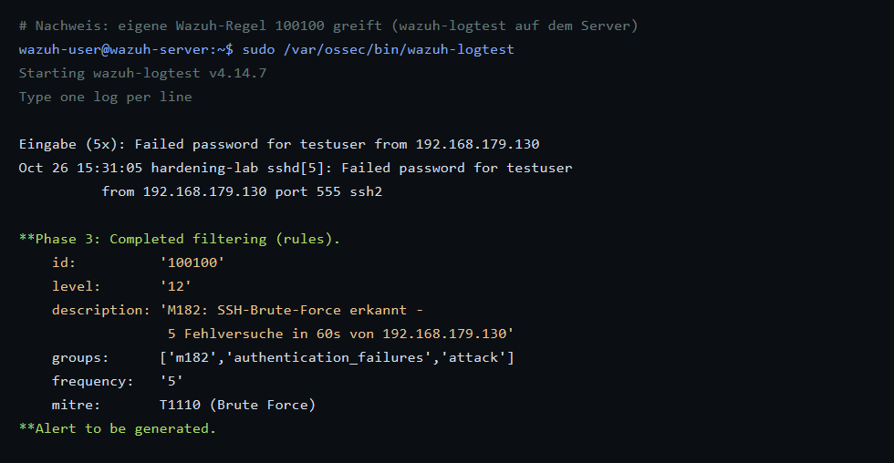

# VM1 – Eigene Regeln und Decoder

Wazuh bringt über 3000 Regeln mit. Für unser Projekt schreiben wir **eigene Regeln**, um:

1. SSH-Brute-Force **schneller und strenger** zu erkennen als die Standardregel,
2. einen **erfolgreichen Login nach einem Brute-Force** als kritisch zu melden,
3. einen **Portscan** über Firewall-Logs der Ubuntu-VM zu erkennen,
4. Änderungen an **besonders kritischen Dateien** höher zu bewerten.

Die fertige Datei liegt unter [config/local_rules.xml](config/local_rules.xml).

## 1. Mitgelieferte Regeln, auf denen wir aufbauen

| Regel-ID | Level | Beschreibung |
|---|---|---|
| 5710 | 5 | sshd: Login-Versuch mit nicht existierendem Benutzer |
| 5715 | 3 | sshd: Authentifizierung erfolgreich |
| 5760 | 5 | sshd: Authentifizierung fehlgeschlagen |
| 5763 | 10 | sshd: Brute Force (8 Fehlversuche in 120 s) |
| 4100 | 0 | Firewall-Ereignisse (Decoder `iptables`) |
| 550 | 7 | FIM: Prüfsumme einer Datei geändert |
| 553 | 7 | FIM: Datei gelöscht |
| 554 | 5 | FIM: Datei hinzugefügt |
| 5902 | 8 | Neuer Benutzer angelegt |

Regeln nachschlagen:

```bash
sudo grep -rn 'id="5763"' -A8 /var/ossec/ruleset/rules/
```

Oder im Dashboard: **Server management → Rules** → nach ID suchen.

## 2. Eigene Regeln einfügen

```bash
sudo cp /var/ossec/etc/rules/local_rules.xml /var/ossec/etc/rules/local_rules.xml.bak
sudo nano /var/ossec/etc/rules/local_rules.xml
```

Inhalt aus [config/local_rules.xml](config/local_rules.xml) einfügen (die Beispielregel `100001` der
Originaldatei kann bleiben oder gelöscht werden).

Konfiguration prüfen und Manager neu starten:

```bash
sudo /var/ossec/bin/wazuh-analysisd -t    # Syntaxprüfung, keine Ausgabe = ok
sudo systemctl restart wazuh-manager
sudo tail -n 30 /var/ossec/logs/ossec.log # auf Fehler (ERROR) prüfen
```

Alternativ im Dashboard: **Server management → Rules → Manage rules files → Custom rules → local_rules.xml**
bearbeiten und speichern → Manager neu starten.

## 3. Erklärung der eigenen Regeln

### Regel 100100 – SSH-Brute-Force (streng)

```xml
<rule id="100100" level="12" frequency="5" timeframe="60">
  <if_matched_group>authentication_failed</if_matched_group>
  <same_source_ip />
  ...
```

- Löst aus, wenn **5** fehlgeschlagene Anmeldungen (Gruppe `authentication_failed`, umfasst u. a. 5710, 5716, 5760)
  innerhalb von **60 Sekunden** von **derselben IP** kommen.
- Level 12 statt 10 → höhere Priorität.
- MITRE ATT&CK: **T1110 – Brute Force**.

### Regel 100101 – Erfolgreicher Login nach Brute-Force

- Löst aus, wenn innerhalb von 5 Minuten nach Regel 100100 ein **erfolgreicher Login** von derselben IP folgt.
- Level 14 → der Angreifer hat das Passwort vermutlich gefunden!
- MITRE: T1110 und **T1078 – Valid Accounts**.

### Regeln 100110 / 100111 – Portscan

Auf der Ubuntu-VM loggt iptables jede neue eingehende TCP-Verbindung mit dem Präfix `M182-SCAN:`
(siehe [VM2 – Konfiguration](../VM2_Ubuntu-Ziel/03_Konfiguration_Ueberwachung.md)). Wazuh dekodiert diese
Kernel-Meldungen mit dem eingebauten Decoder `iptables` (Felder `srcip`, `dstip`, `dstport`, `protocol`).

- **100110** (Level 3): einzelne neue Verbindung.
- **100111** (Level 10): **15 verschiedene Zielports in 20 Sekunden** von derselben IP → Portscan.
- MITRE: **T1046 – Network Service Discovery**.

### Regeln 100120–100122 – Kritische Dateien

| Regel | Auslöser | Level |
|---|---|---|
| 100120 | Änderung an `/etc/passwd`, `/etc/shadow`, `/etc/sudoers`, `/etc/ssh/sshd_config` | 12 |
| 100121 | Neue Datei in `/etc/sudoers.d/` | 12 |
| 100122 | `authorized_keys` neu oder geändert | 10 |

Standardmässig meldet Wazuh solche Änderungen nur mit Level 7. Mit den eigenen Regeln werden sie deutlich höher
priorisiert.

## 4. Regeln testen mit `wazuh-logtest`

```bash
sudo /var/ossec/bin/wazuh-logtest
```

Dann eine Logzeile einfügen, z. B.:

```text
Oct 19 14:12:01 hardening-lab sshd[1234]: Failed password for testuser from 192.168.179.130 port 51234 ssh2
```

Ausgabe (gekürzt):

```text
**Phase 2: Completed decoding.
        name: 'sshd'
        srcip: '192.168.179.130'
        dstuser: 'testuser'
**Phase 3: Completed filtering (rules).
        id: '5760'
        level: '5'
        description: 'sshd: authentication failed.'
```

Fügt man dieselbe Zeile **5-mal** ein, erscheint Regel **100100**.

Test für den Portscan (Kernel-Meldung von iptables):

```text
Oct 19 14:20:01 hardening-lab kernel: [ 1234.567890] M182-SCAN: IN=ens33 OUT= MAC=08:00:27:aa:bb:cc:08:00:27:dd:ee:ff:08:00 SRC=192.168.179.130 DST=192.168.179.128 LEN=44 TOS=0x00 PREC=0x00 TTL=52 ID=12345 PROTO=TCP SPT=54321 DPT=80 WINDOW=1024 RES=0x00 SYN URGP=0
```

Erwartet: Decoder `iptables`, `srcip: 192.168.179.130`, `dstport: 80`, Regel **100110**.

> **Falls der Decoder `iptables` nicht greift** (z. B. weil das Log-Format anders ist), zeigt `wazuh-logtest`
> nur `kernel` als Decoder. Dann folgenden eigenen Decoder in `/var/ossec/etc/decoders/local_decoder.xml`
> eintragen und in Regel 100110 `<if_sid>4100</if_sid>` durch `<decoded_as>m182-scan</decoded_as>` ersetzen:
>
> ```xml
> <decoder name="m182-scan">
>   <prematch>M182-SCAN: </prematch>
> </decoder>
>
> <decoder name="m182-scan-fields">
>   <parent>m182-scan</parent>
>   <regex offset="after_parent">SRC=(\S+) DST=(\S+) \.+PROTO=(\S+) SPT=(\d+) DPT=(\d+)</regex>
>   <order>srcip,dstip,protocol,srcport,dstport</order>
> </decoder>
> ```

## 5. Ergebnis dokumentieren

| Test mit wazuh-logtest | Erwartete Regel | Ergebnis |
|---|---|---|
| 1× `Failed password` | 5760 | [AUSFÜLLEN] |
| 5× `Failed password` | 100100 | [AUSFÜLLEN] |
| iptables-Zeile `M182-SCAN` | 100110 | [AUSFÜLLEN] |


