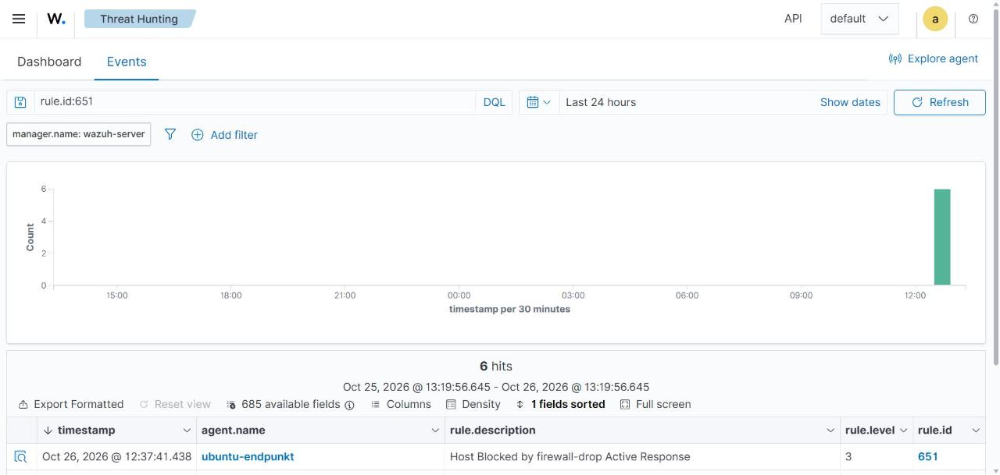

# VM1 – Active Response: Angreifer-IP automatisch sperren

Mit **Active Response** reagiert Wazuh automatisch auf Alerts. Wir verwenden das mitgelieferte Skript
**`firewall-drop`**. Es fügt auf dem betroffenen Agent eine iptables-Regel ein, die alle Pakete der Angreifer-IP
verwirft. Nach Ablauf des Timeouts wird die Sperre automatisch wieder aufgehoben.

Damit wird Wazuh vom reinen **IDS** zu einem **IPS** (Intrusion Prevention).

## 1. Ablauf

```text
Kali (192.168.179.130)            Ubuntu-Agent                    Wazuh-Manager
   │  hydra ssh-Angriff  ───────▶ sshd: Failed password
   │                             auth.log ───────────────────▶ Regel 100100 (Level 12)
   │                                                            │ active-response: firewall-drop
   │                             ◀──────────────────────────────┘
   │                             iptables -I INPUT -s 192.168.179.130 -j DROP
   │  ✗ keine Verbindung mehr
   │                             ... nach 600 s: Sperre entfernt
```

## 2. Konfiguration auf dem Manager

```bash
sudo cp /var/ossec/etc/ossec.conf /var/ossec/etc/ossec.conf.bak
sudo nano /var/ossec/etc/ossec.conf
```

Den Block aus [config/ossec_manager_active-response.xml](config/ossec_manager_active-response.xml) einfügen:

```xml
<!-- im bestehenden <global>-Abschnitt ergänzen -->
<white_list>192.168.179.129</white_list>
<white_list>192.168.179.1</white_list>

<!-- neuer Abschnitt innerhalb von <ossec_config> -->
<active-response>
  <disabled>no</disabled>
  <command>firewall-drop</command>
  <location>local</location>
  <rules_id>5763,100100,100111</rules_id>
  <timeout>600</timeout>
</active-response>
```

| Option | Bedeutung |
|---|---|
| `command` | Welches Skript ausgeführt wird (`/var/ossec/active-response/bin/firewall-drop` auf dem Agent) |
| `location` | `local` = auf dem Agent, der den Alert erzeugt hat. Alternativen: `server`, `defined-agent`, `all` |
| `rules_id` | Bei welchen Regeln reagiert wird |
| `timeout` | Dauer der Sperre in Sekunden |
| `white_list` | Diese IPs werden **nie** gesperrt (Schutz vor Selbstaussperrung) |

> **Achtung:** Kali **nicht** in die `white_list` eintragen, sonst wird der Angreifer nie gesperrt.
> Den Host-PC (`192.168.179.1`) und den Server dagegen schon.

Prüfen, ob der Befehl `firewall-drop` definiert ist:

```bash
sudo grep -A4 '<name>firewall-drop</name>' /var/ossec/etc/ossec.conf
```

Neustart:

```bash
sudo systemctl restart wazuh-manager
```

## 3. Manueller Test (ohne Angriff)

```bash
# Liste der Agents und deren IDs
sudo /var/ossec/bin/agent_control -l

# IP 192.168.179.130 auf Agent 001 (ubuntu-endpunkt) sperren
sudo /var/ossec/bin/agent_control -b 192.168.179.130 -f firewall-drop0 -u 001
```

Auf der Ubuntu-VM prüfen:

```bash
sudo iptables -L INPUT -n --line-numbers | grep 192.168.179.130
sudo tail -n 20 /var/ossec/logs/active-responses.log
```

> Der Name `firewall-drop0` setzt sich aus Befehl + Timeout-Flag zusammen. Mit
> `sudo /var/ossec/bin/agent_control -L` werden die verfügbaren Active Responses angezeigt.

## 4. Test mit echtem Angriff

Siehe [VM3 – Angriffsszenarien, Szenario 1](../VM3_Kali-Angreifer/03_Angriffsszenarien.md).

Erwartetes Ergebnis:

1. Hydra beginnt mit den Anmeldeversuchen.
2. Nach ca. 5 Fehlversuchen erscheint Alert **100100** im Dashboard.
3. Direkt danach erscheint ein Alert mit Regel **651** – *"Host Blocked by firewall-drop Active Response"*.
4. Hydra meldet Verbindungsfehler / Timeouts.
5. `ping 192.168.179.128` von Kali schlägt fehl.
6. Nach 600 Sekunden: Regel **652** – Sperre aufgehoben, Kali erreicht Ubuntu wieder.

## 5. Im Dashboard anzeigen

**Threat Hunting → Events**, Filter:

```text
rule.id:(100100 OR 5763 OR 651 OR 652) and agent.name:ubuntu-endpunkt
```



## 6. Risiken von Active Response

| Risiko | Gegenmassnahme |
|---|---|
| Legitime Benutzer sperren sich selbst aus (Tippfehler) | Moderater Schwellenwert, kurzer Timeout, Whitelist für Admin-Netz |
| Angreifer fälscht Quell-IPs (Spoofing) → Sperre wichtiger Systeme (DoS) | Whitelist, nur für TCP-basierte Ereignisse (SSH) verwenden – dort ist Spoofing kaum möglich |
| Angreifer wechselt die IP | Zusätzlich Fail2ban/SSH-Key-Login, Rate-Limiting |
| Sperre geht nach Neustart verloren | Für dauerhafte Sperren zusätzlich Firewall-Regel manuell setzen |
