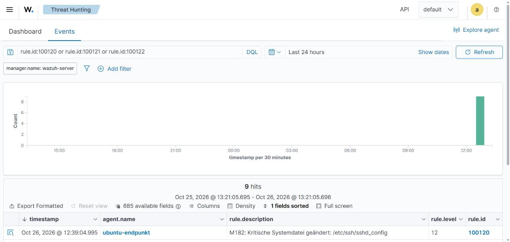

# VM2 – Konfiguration der Überwachung

Alle Ergänzungen für die Agent-Konfiguration stehen in [config/ossec_agent_ubuntu.xml](config/ossec_agent_ubuntu.xml).

```bash
sudo cp /var/ossec/etc/ossec.conf /var/ossec/etc/ossec.conf.bak
sudo nano /var/ossec/etc/ossec.conf
```

## 1. Log-Sammlung einrichten

Zuerst prüfen, welche Logs bereits überwacht werden:

```bash
sudo grep -A3 '<localfile>' /var/ossec/etc/ossec.conf
```

Fehlen `/var/log/auth.log` und `/var/log/syslog`, die `<localfile>`-Blöcke aus der Config-Datei einfügen.

| Logdatei | Inhalt | Wichtig für |
|---|---|---|
| `/var/log/auth.log` | SSH-Logins, `sudo`, `useradd` | SSH-Brute-Force, Benutzeränderungen |
| `/var/log/syslog` | Systemmeldungen inkl. Kernel (iptables) | Portscan-Erkennung |
| `/var/log/audit/audit.log` | auditd-Ereignisse | FIM whodata (wer hat geändert) |

> `kern.log` wird **nicht** zusätzlich eingebunden, da die Kernelmeldungen bereits in `syslog` stehen.
> Sonst kommen alle Firewall-Ereignisse doppelt. Gleiches gilt für einen eventuell vorhandenen
> `journald`-Eintrag: Werden sshd-Meldungen doppelt angezeigt, eine der beiden Quellen entfernen.

## 2. File Integrity Monitoring (FIM)

Den bestehenden `<syscheck>`-Abschnitt gemäss Config-Datei anpassen. Wichtigste Punkte:

| Option | Bedeutung |
|---|---|
| `realtime="yes"` | Änderungen werden **sofort** gemeldet (inotify), nicht erst beim nächsten Scan |
| `whodata="yes"` | Zusätzlich wird erfasst, **welcher Benutzer / Prozess** die Datei geändert hat (benötigt auditd, beinhaltet Echtzeit) |
| `report_changes="yes"` | Zeigt im Alert die **geänderten Zeilen** (diff) |
| `check_all="yes"` | Prüft Hash (MD5/SHA1/SHA256), Grösse, Besitzer, Rechte, Änderungszeit |
| `<ignore>` | Dateien, die sich ständig ändern → weniger Fehlalarme |
| `<nodiff>` | Inhalt wird nicht gespeichert (Passwort-Hashes!) |

auditd muss laufen:

```bash
sudo systemctl enable --now auditd
sudo auditctl -l   # nach dem Agent-Neustart sind hier Wazuh-Regeln (-k wazuh_fim) sichtbar
```

## 3. Firewall-Logging für Portscan-Erkennung

Ein HIDS sieht einen Portscan **nicht direkt**, weil geschlossene Ports nichts loggen. Deshalb lassen wir iptables
jede neue eingehende TCP-Verbindung ins Kernel-Log schreiben. Wazuh wertet diese Logzeilen aus
(Regeln 100110 / 100111 auf dem Server).

```bash
# Interface im Host-only-Netz ermitteln (z. B. enp0s8)
ip -br a

# Jede neue TCP-Verbindung (SYN) aus dem Testnetz loggen, max. 50 Zeilen/s pro Quelle
sudo iptables -A INPUT -i enp0s8 -s 192.168.56.0/24 -p tcp --syn \
  -m conntrack --ctstate NEW \
  -m hashlimit --hashlimit-upto 50/sec --hashlimit-mode srcip --hashlimit-name m182scan \
  -j LOG --log-prefix "M182-SCAN: " --log-level 4

sudo iptables -L INPUT -n -v --line-numbers
```

Testen (von einer anderen VM eine Verbindung aufbauen, z. B. `nc -zv 192.168.56.20 80`), danach:

```bash
sudo grep "M182-SCAN" /var/log/syslog | tail -n 3
```

Regeln dauerhaft speichern:

```bash
sudo apt install -y iptables-persistent
sudo netfilter-persistent save
```

> **Hinweis:** Die LOG-Regel blockiert nichts, sie protokolliert nur. Die Sperre durch Active Response
> (`firewall-drop`) wird **vor** dieser Regel eingefügt (`iptables -I`), dadurch werden gesperrte Pakete
> nicht mehr geloggt.

## 4. Active Response auf dem Agent

Active Response muss auf dem Agent erlaubt sein (Standard):

```xml
<active-response>
  <disabled>no</disabled>
</active-response>
```

Das Skript liegt unter `/var/ossec/active-response/bin/firewall-drop`, das Log unter
`/var/ossec/logs/active-responses.log`.

## 5. Neustart und Kontrolle

```bash
sudo systemctl restart wazuh-agent
sudo tail -n 50 /var/ossec/logs/ossec.log | grep -Ei "error|warn|syscheck|logcollector"
```

Erwartet u. a.:

```text
wazuh-logcollector: INFO: (1950): Analyzing file: '/var/log/auth.log'.
wazuh-syscheckd: INFO: (6012): Real-time file integrity monitoring started.
```

## 6. Funktionstest FIM

```bash
echo "Konfiguration v2 - geändert" | sudo tee -a /opt/m182-wichtig/app.conf
```

Im Dashboard → **File Integrity Monitoring → Events** → Agent `ubuntu-target`:
Alert **550** *"Integrity checksum changed"* mit Diff und Benutzer (`whodata`).



## 7. SCA und Schwachstellen

Nach einigen Minuten im Dashboard prüfen:

- **Configuration Assessment** → Policy *CIS Ubuntu Linux 24.04 LTS Benchmark* → Score und fehlgeschlagene Checks
- **Vulnerability Detection** → Liste der CVEs mit Schweregrad

Die wichtigsten Ergebnisse in [03_Auswertung_Wirksamkeit.md](../03_Auswertung_Wirksamkeit.md) eintragen.

## 8. Snapshot

Snapshot `03_konfiguriert` erstellen – **vor** den Angriffen.
