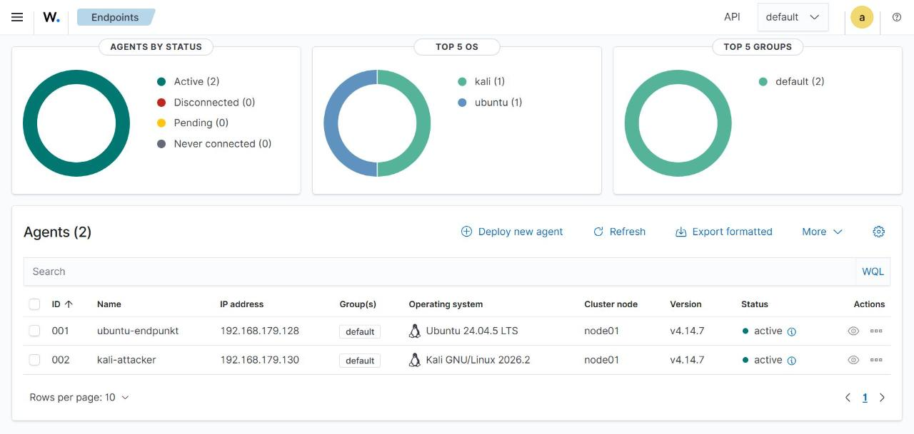

# VM3 – Wazuh-Agent auf Kali installieren

Kali basiert auf Debian, deshalb funktioniert das DEB-Paket wie bei Ubuntu.

```bash
# GPG-Schlüssel importieren
curl -s https://packages.wazuh.com/key/GPG-KEY-WAZUH | \
  sudo gpg --no-default-keyring --keyring gnupg-ring:/usr/share/keyrings/wazuh.gpg --import
sudo chmod 644 /usr/share/keyrings/wazuh.gpg

# Repository hinzufügen
echo "deb [signed-by=/usr/share/keyrings/wazuh.gpg] https://packages.wazuh.com/4.x/apt/ stable main" | \
  sudo tee /etc/apt/sources.list.d/wazuh.list
sudo apt update

# Agent installieren, Manager-Adresse und Namen setzen
sudo WAZUH_MANAGER="192.168.56.10" WAZUH_AGENT_NAME="kali-attacker" apt install -y wazuh-agent

# Updates festhalten
sudo sed -i "s/^deb /#deb /" /etc/apt/sources.list.d/wazuh.list
sudo apt update
```

Agent starten:

```bash
sudo systemctl daemon-reload
sudo systemctl enable wazuh-agent
sudo systemctl start wazuh-agent
sudo systemctl status wazuh-agent
```

Verbindung prüfen:

```bash
sudo grep -i "connected to the server" /var/ossec/logs/ossec.log
```

Auf dem Manager müssen jetzt **beide** Agents erscheinen:

```bash
sudo /var/ossec/bin/agent_control -l
```

```text
   ID: 001, Name: ubuntu-target,  IP: any, Active
   ID: 002, Name: kali-attacker,  IP: any, Active
```



> **Zweck des Agents auf Kali:** Damit ist die Anforderung „mindestens zwei Agents“ erfüllt. Ausserdem
> sammelt Wazuh auch hier SCA-, Schwachstellen- und Prozessdaten. Für die Angriffserkennung ist aber der
> Agent auf der **Ubuntu-VM** entscheidend.
