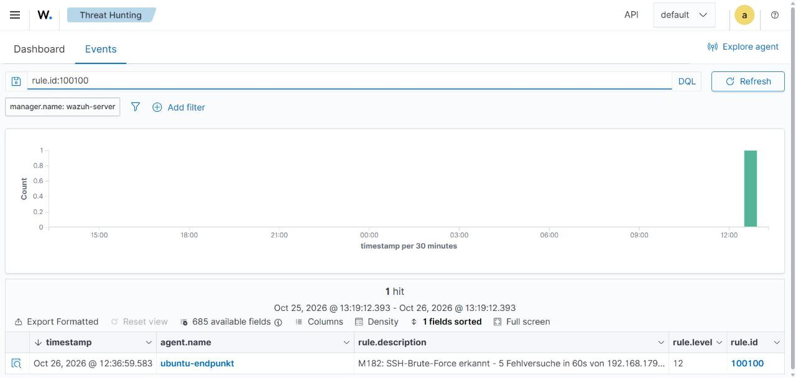
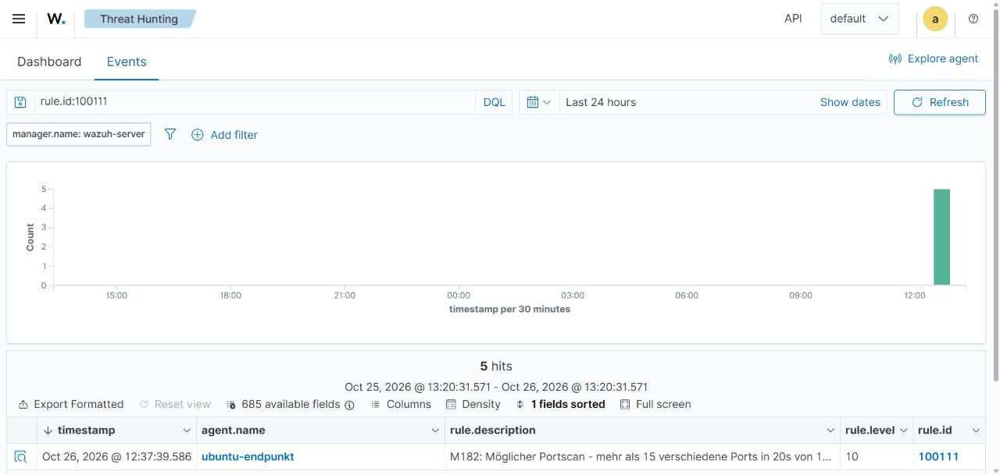

# VM3 – Angriffsszenarien

Drei Szenarien gegen `ubuntu-target` (192.168.56.20). Nach jedem Angriff wird im Wazuh-Dashboard geprüft, welche
Alerts entstanden sind. Vor dem Start den Snapshot `03_konfiguriert` auf allen VMs sicherstellen.

**Dashboard-Ansicht während der Tests:** *Threat Hunting → Events*, Agent-Filter `agent.name:ubuntu-target`,
Zeitbereich „Last 15 minutes“, Auto-Refresh an.

---

## Szenario 1: SSH-Brute-Force

**Ziel:** Passwort des Benutzers `testuser` per Wörterbuchangriff erraten.
**Erwartete Erkennung:** Regeln 5760 → 5763 / 100100, danach Active Response (IP-Sperre).

```bash
hydra -L ~/m182-users.txt -P ~/m182-passwords.txt -t 4 -f ssh://192.168.56.20
```

| Option | Bedeutung |
|---|---|
| `-L` | Datei mit Benutzernamen |
| `-P` | Datei mit Passwörtern |
| `-t 4` | 4 parallele Versuche |
| `-f` | Stoppen, sobald ein gültiges Paar gefunden wurde |

**Beobachtung während des Angriffs:**

1. Im Dashboard erscheinen mehrere Alerts **5760** *(authentication failed)*.
2. Nach ca. 5 Versuchen: Alert **100100** (Level 12) und/oder **5763**.
3. Alert **651** *(Host Blocked by firewall-drop)* → Active Response hat zugeschlagen.
4. Hydra bleibt hängen / meldet Timeouts, weil die IP gesperrt ist.

Sperre auf der Ubuntu-VM prüfen:

```bash
# auf VM2:
sudo iptables -L INPUT -n --line-numbers | grep 192.168.56.30
sudo tail -f /var/ossec/logs/active-responses.log
```

Von Kali aus prüfen, dass die Verbindung blockiert ist:

```bash
ssh testuser@192.168.56.20   # -> Timeout / no route
```

> **Variante ohne Active Response** (um nur die Erkennung zu zeigen): den `<active-response>`-Block auf dem
> Manager vorübergehend auf `<disabled>yes</disabled>` setzen und Manager neu starten. Dann läuft Hydra durch
> und man sieht ggf. Alert **100101** (erfolgreicher Login nach Brute-Force), falls das Passwort in der Liste war.

| Prüfpunkt | Erwartet | Ergebnis |
|---|---|---|
| Alert 5760 sichtbar | ja | [AUSFÜLLEN] |
| Alert 100100 / 5763 | ja | [AUSFÜLLEN] |
| Active Response (651) | ja | [AUSFÜLLEN] |
| IP auf VM2 gesperrt | ja | [AUSFÜLLEN] |
| Zeit bis zur Sperre | ca. [AUSFÜLLEN] s | [AUSFÜLLEN] |



---

## Szenario 2: Portscan

**Ziel:** Offene Dienste auf der Ubuntu-VM finden.
**Erwartete Erkennung:** Regeln 100110 (einzelne Verbindung) → 100111 (Portscan, Level 10).

> Falls die IP aus Szenario 1 noch gesperrt ist: 600 s warten oder auf VM2 die Sperre entfernen:
> `sudo iptables -D INPUT -s 192.168.56.30 -j DROP`

```bash
# TCP-Connect-Scan der 1000 häufigsten Ports (erzeugt saubere Logzeilen)
nmap -sT -p 1-1000 192.168.56.20

# Variante: schneller SYN-Scan über viele Ports
sudo nmap -sS -p 1-1000 --min-rate 500 192.168.56.20
```

**Beobachtung:**

1. Viele Alerts **100110** (je neue Verbindung, Level 3).
2. Sammel-Alert **100111** *(Möglicher Portscan, Level 10)* mit `srcip 192.168.56.30`.
3. MITRE-Technik **T1046** im Alert sichtbar.
4. Da 100111 ebenfalls in der Active-Response-Liste steht, wird Kali auch hier gesperrt.

Auf VM2 kontrollieren:

```bash
sudo grep "M182-SCAN" /var/log/syslog | tail -n 20
```

| Prüfpunkt | Erwartet | Ergebnis |
|---|---|---|
| Alerts 100110 | mehrere | [AUSFÜLLEN] |
| Alert 100111 (Portscan) | ja | [AUSFÜLLEN] |
| MITRE T1046 | ja | [AUSFÜLLEN] |
| Active Response | ja | [AUSFÜLLEN] |



---

## Szenario 3: Änderung an kritischen Systemdateien

**Ziel:** Zeigen, dass FIM Manipulationen am System erkennt. Dieser Teil wird **auf der Ubuntu-VM** ausgeführt
(als wäre der Angreifer bereits eingedrungen). Dazu per SSH einloggen (nur möglich, wenn Kali gerade nicht
gesperrt ist) oder direkt an der VM2-Konsole arbeiten.

```bash
# auf VM2 als root/sudo:

# 1) Neuen Benutzer anlegen (simuliert Backdoor-Konto)
sudo useradd -m -s /bin/bash hacker

# 2) Dem Benutzer sudo-Rechte geben (Rechteausweitung)
echo "hacker ALL=(ALL) NOPASSWD:ALL" | sudo tee /etc/sudoers.d/99-hacker

# 3) SSH-Konfiguration manipulieren
echo "# backdoor" | sudo tee -a /etc/ssh/sshd_config

# 4) SSH-Schlüssel als Persistenz hinterlegen
sudo mkdir -p /root/.ssh
echo "ssh-ed25519 AAAA...tasted-key m182-test" | sudo tee -a /root/.ssh/authorized_keys
```

**Erwartete Erkennung:**

| Aktion | Regel | Level |
|---|---|---|
| `/etc/sudoers.d/99-hacker` angelegt | **100121** | 12 |
| `/etc/ssh/sshd_config` geändert | **100120** | 12 |
| `/root/.ssh/authorized_keys` angelegt | **100122** | 10 |
| neuer Benutzer `hacker` | 5902 (Standard) | 8 |

Da `whodata` aktiv ist, zeigt der Alert zusätzlich, **welcher Benutzer** die Änderung gemacht hat.

**Aufräumen nach dem Test:**

```bash
sudo deluser --remove-home hacker
sudo rm /etc/sudoers.d/99-hacker
sudo sed -i '/# backdoor/d' /etc/ssh/sshd_config
sudo sed -i '/m182-test/d' /root/.ssh/authorized_keys
```

| Prüfpunkt | Erwartet | Ergebnis |
|---|---|---|
| Alert 100121 (sudoers) | ja | [AUSFÜLLEN] |
| Alert 100120 (sshd_config) | ja | [AUSFÜLLEN] |
| Alert 100122 (authorized_keys) | ja | [AUSFÜLLEN] |
| whodata zeigt Benutzer | ja | [AUSFÜLLEN] |


---

## Nach allen Tests

- Snapshots `03_konfiguriert` zurückspielen, um einen sauberen Stand zu erhalten.
- Ergebnisse in [03_Auswertung_Wirksamkeit.md](../03_Auswertung_Wirksamkeit.md) eintragen.
