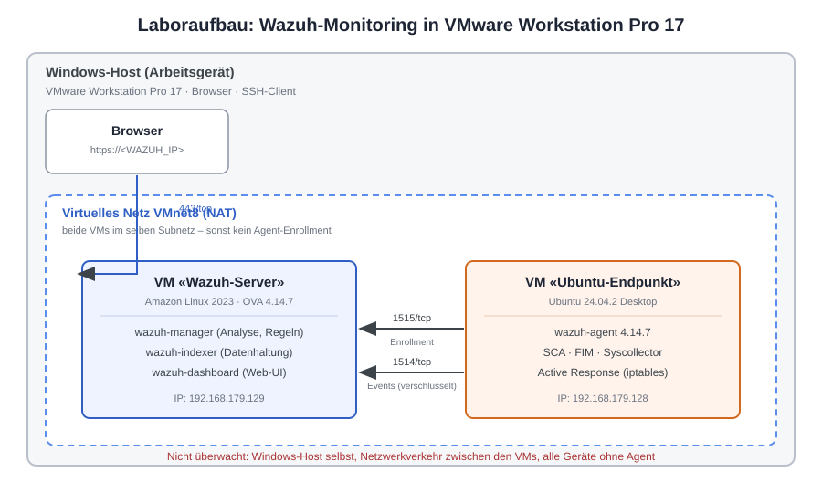
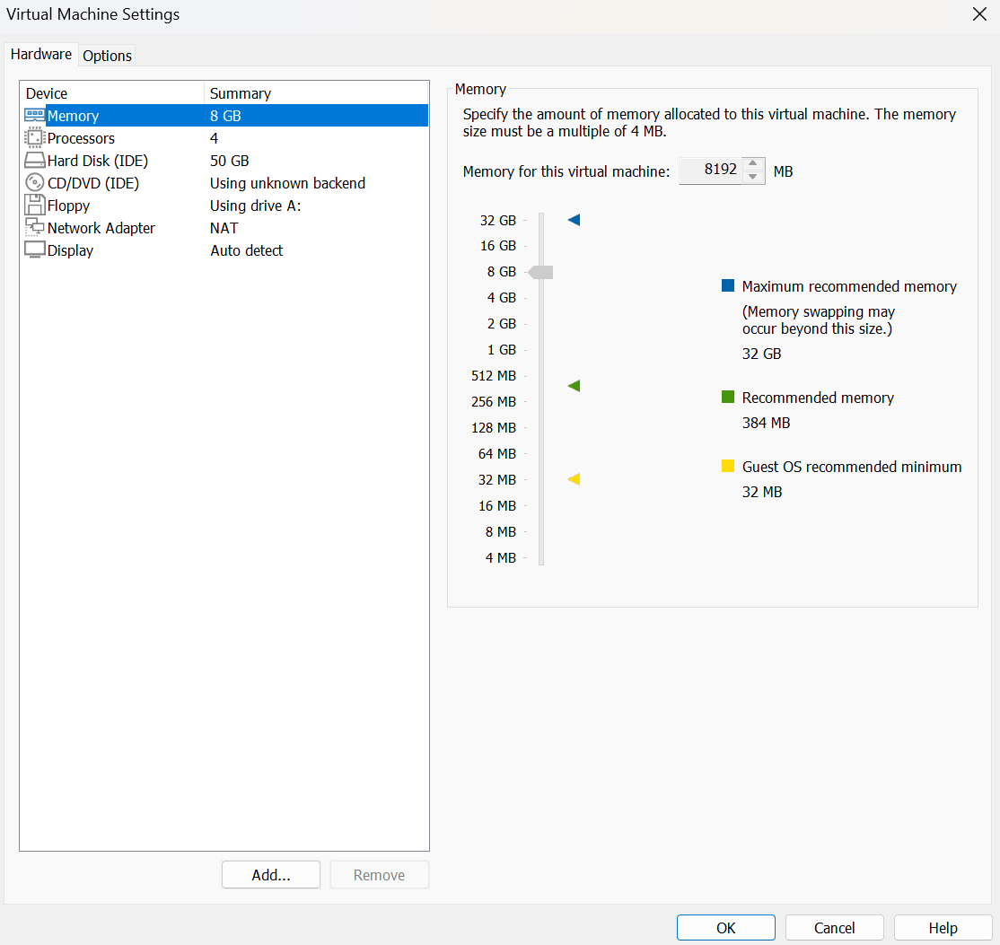
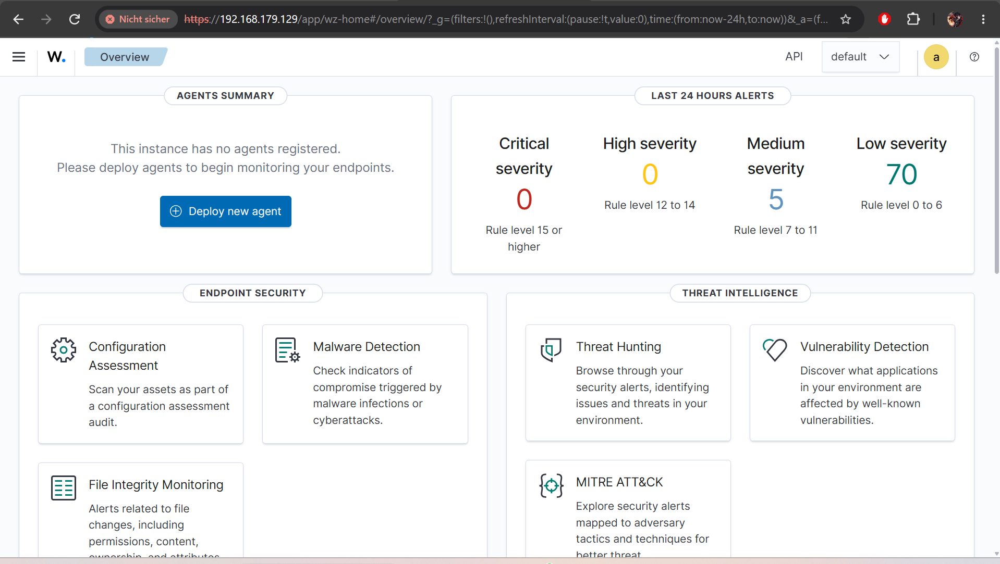
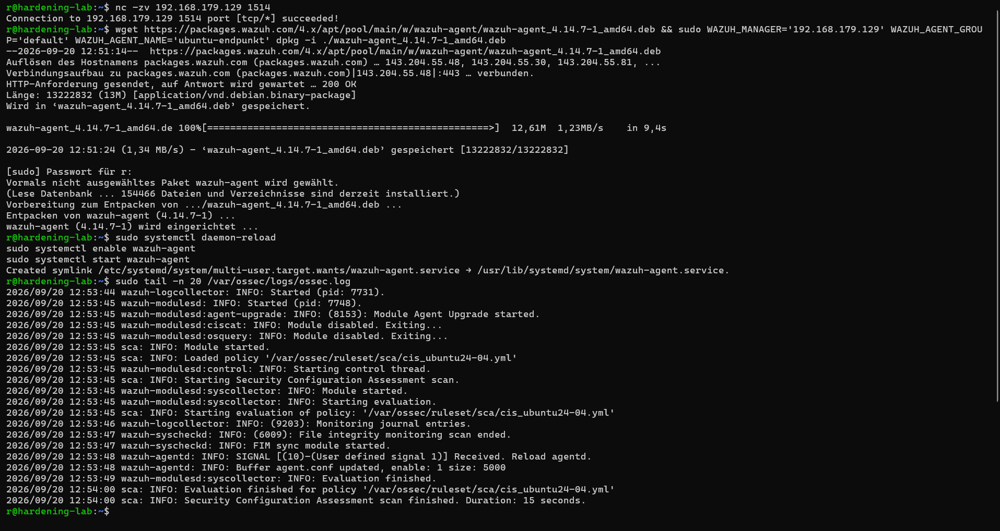
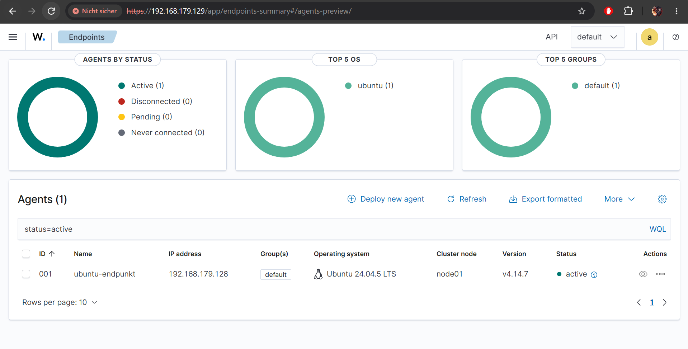
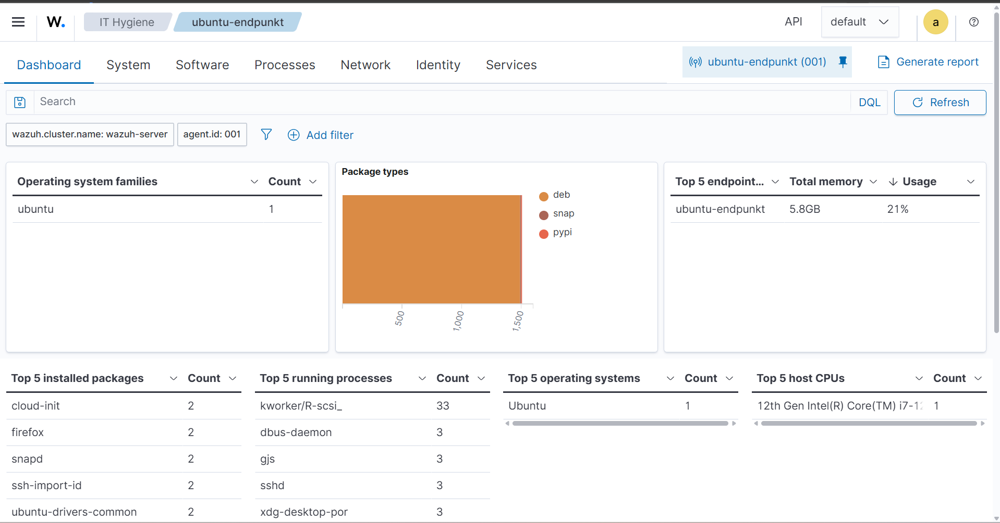
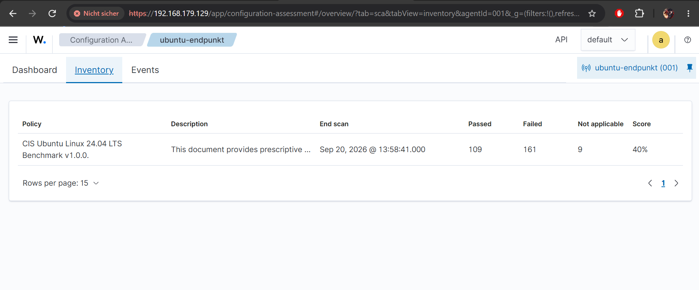

# Monitoring der Endpunkte mit Wazuh

**Auftrag:** Monitoring der Endpunkte mit wazuh
**Kompetenzband:** D – HIDS in Betrieb nehmen
**Bearbeitete Stufe:** B (D1B) mit Härtung des überwachten Systems
**Verfasser:** Rewan Ezzeldin
**Datum:** 20. September 2026

---

## Inhaltsverzeichnis

1. [Umgebung und Aufbau](#1-umgebung-und-aufbau)
2. [Installation der zentralen Komponenten](#2-installation-der-zentralen-komponenten)
3. [Installation des Agenten](#3-installation-des-agenten)
4. [Auswertung des Dashboards](#4-auswertung-des-dashboards)
5. [Härtung des Systems](#5-härtung-des-systems)
6. [Aufgetretene Probleme und Lösungen](#6-aufgetretene-probleme-und-lösungen)
7. [Fazit](#7-fazit)
8. [Anhang](#8-anhang)

---

## 1. Umgebung und Aufbau

### 1.1 Eingesetzte Systeme

| Rolle | System | Version | IP-Adresse |
|---|---|---|---|
| Host | Windows mit VMware Workstation Pro 17 | 17.5.x | – |
| Zentrale Komponenten | VM «Wazuh-Server», Amazon Linux 2023 | Wazuh 4.14.7 | 192.168.179.129 |
| Überwachter Endpunkt | VM «Ubuntu-Endpunkt», Hostname `hardening-lab` | Ubuntu 24.04.2 Desktop | 192.168.179.128 |
| Agent | wazuh-agent, DEB amd64 | 4.14.7 | – |

### 1.2 Begründung der Aufbauentscheide

**Singlenode statt Multinode.** Ein Multinode-Cluster dient der Ausfallsicherheit und der Lastverteilung bei mehreren hundert Agenten. Bei einem einzelnen überwachten Endpunkt bringt das keinen Nutzen und kostet nur Ressourcen, weshalb ich einen Singlenode-Cluster einsetze.

**Vorinstallierte VM statt Docker.** Die OVA liefert Manager, Indexer und Dashboard fertig konfiguriert aus, ohne Zertifikatsgenerierung und ohne Kernel-Tuning. Entscheidender war aber die Netzwerkfrage: Der überwachte Endpunkt liegt ebenfalls als VM in VMware, also stehen beide Maschinen im selben virtuellen Netz und erreichen sich direkt. Bei Docker Desktop unter Windows läge der Server hinter dem WSL2-NAT, wodurch die Verbindung aus einer anderen VM nur über zusätzliche Portweiterleitungen funktioniert hätte.

**Test-VM statt Arbeitsgerät.** Überwacht wird bewusst eine Test-VM und nicht mein Arbeitsgerät. Änderungen an Systemeinstellungen wären dort ohne Absprache nicht zulässig. Der Auftrag lässt diese Variante ausdrücklich zu.

### 1.3 Netzwerkaufbau



Beide VMs hängen am NAT-Netz VMnet8 und stehen damit im selben Subnetz 192.168.179.0/24. Ein Bridged-Adapter wäre im Schulnetz unzuverlässig, weil DHCP-Vergabe oder Client-Isolation die Verbindung zwischen den Maschinen verhindern können.

| Port | Protokoll | Zweck |
|---|---|---|
| 1514 | TCP | Agent → Manager: verschlüsselte Übermittlung der Events |
| 1515 | TCP | Agent → Manager: Enrollment, Bezug des Agent-Schlüssels |
| 443 | TCP | Browser → Dashboard |
| 55000 | TCP | Wazuh-Server-API, vom Dashboard genutzt |

### 1.4 Rolle der Komponenten

| Komponente | Aufgabe |
|---|---|
| wazuh-manager | Nimmt die Agent-Daten entgegen, dekodiert sie und gleicht sie gegen das Regelwerk ab |
| wazuh-indexer | Speichert und indexiert die Alarme |
| wazuh-dashboard | Web-Oberfläche zur Auswertung |
| wazuh-agent | Dienst auf dem Endpunkt, sammelt Logs, Inventar und Konfigurationsprüfungen |

---

## 2. Installation der zentralen Komponenten

### 2.1 Import der OVA

Verwendet wurde die vorinstallierte virtuelle Maschine `wazuh-4.14.7.ova` von `https://packages.wazuh.com/4.x/vm/`. Der Import erfolgte in VMware Workstation über *Datei → Öffnen*. Die Meldung, die Datei erfülle die OVF-Spezifikation nicht, liess sich mit *Retry* übergehen; sie betrifft nur die strikte Schemaprüfung und hat keine Auswirkung auf den Betrieb.

Der Weg über den *New Virtual Machine Wizard* führt nicht zum Ziel, da dieser eine leere VM ohne Betriebssystem erzeugt.

### 2.2 VM-Einstellungen

| Einstellung | Wert | Bemerkung |
|---|---|---|
| Arbeitsspeicher | 8192 MB | Standardwert der OVA, vom Host mit 32 GB problemlos tragbar |
| Prozessoren | 4 | unverändert |
| Festplatte | 50 GB (IDE) | unverändert |
| Netzwerkadapter | NAT (VMnet8) | von Bridged umgestellt, siehe Abschnitt 1.3 |



### 2.3 Erster Start und Netzwerkkonfiguration

Die Anmeldung an der Konsole erfolgt mit dem Benutzer `wazuh-user` und dem Passwort `wazuh`. Der SSH-Login als root ist deaktiviert, `wazuh-user` verfügt über sudo-Rechte.

```bash
ip a
```

```
2: eth0: <BROADCAST,MULTICAST,UP,LOWER_UP> mtu 1500 qdisc fq_codel state UP group default qlen 1000
    link/ether 00:0c:29:63:75:1d brd ff:ff:ff:ff:ff:ff
    inet 192.168.179.129/24 metric 1024 brd 192.168.179.255 scope global dynamic eth0
       valid_lft 1323sec preferred_lft 1323sec
```

Die Angabe `valid_lft` zeigt, dass die Adresse vom DHCP des VMnet8 geliehen ist und nach einem Neustart wechseln könnte. Da die Manager-IP fest in der Konfiguration des Agenten hinterlegt wird, wäre der Agent danach nicht mehr verbunden. Diesen Zusammenhang habe ich vor der Agent-Installation berücksichtigt.

Ab diesem Punkt habe ich über SSH aus einem Windows-Terminal gearbeitet statt über die VMware-Konsole. Das ermöglicht Kopieren und Einfügen sowie scrollbare Ausgaben, was bei der Fehlersuche entscheidend war.

```powershell
ssh wazuh-user@192.168.179.129
```

### 2.4 Inbetriebnahme der Dienste

Der erste Statuscheck zeigte, dass keine der drei Komponenten lief:

```bash
sudo systemctl status wazuh-manager wazuh-indexer wazuh-dashboard --no-pager
```

```
wazuh-manager.service   Active: inactive (dead)
wazuh-indexer.service   Active: failed (Result: timeout)
wazuh-dashboard.service Active: inactive (dead)
```

Die Ursachenanalyse und die Behebung sind in Kapitel 6 dokumentiert. Nach den dort beschriebenen Anpassungen und einem Neustart der VM liefen alle drei Dienste:

```bash
sudo systemctl status wazuh-indexer wazuh-manager wazuh-dashboard --no-pager | grep Active
```

```
Active: active (running) since Sun 2026-09-20 10:25:04 UTC
Active: active (running) since Sun 2026-09-20 10:26:39 UTC
Active: active (running) since Sun 2026-09-20 10:23:57 UTC
```

Kontrolle der einzelnen Manager-Prozesse:

```bash
sudo /var/ossec/bin/wazuh-control status
```

```
wazuh-modulesd is running...
wazuh-monitord is running...
wazuh-logcollector is running...
wazuh-remoted is running...
wazuh-syscheckd is running...
wazuh-analysisd is running...
wazuh-execd is running...
wazuh-db is running...
wazuh-authd is running...
wazuh-apid is running...
```

Die Dienste `wazuh-clusterd`, `wazuh-maild`, `wazuh-agentlessd`, `wazuh-csyslogd` und `wazuh-integratord` sind nicht aktiv. Das ist der erwartete Zustand einer Standardinstallation: Sie werden nur für Multinode-Cluster, E-Mail-Versand, agentenlose Überwachung und externe Integrationen benötigt, die hier nicht eingerichtet sind.

Kontrolle der offenen Ports:

```bash
sudo ss -tlnp | grep -E '1514|1515|55000'
```

```
LISTEN 0 2048 0.0.0.0:55000 0.0.0.0:* users:(("python3",pid=7391,fd=47))
LISTEN 0  128 0.0.0.0:1515  0.0.0.0:* users:(("wazuh-authd",pid=7435,fd=6))
LISTEN 0  128 0.0.0.0:1514  0.0.0.0:* users:(("wazuh-remoted",pid=7514,fd=4))
```

Damit ist der Server bereit, Agenten aufzunehmen: `wazuh-authd` auf 1515 für das Enrollment, `wazuh-remoted` auf 1514 für die Events.

### 2.5 Zugang zum Dashboard

Das Dashboard ist unter `https://192.168.179.129` erreichbar. Wichtig ist das vorangestellte `https://` – ohne Protokollangabe versucht der Browser Port 80, auf dem nichts antwortet. Port 55000 führt ebenfalls nicht zum Ziel: Dort läuft die API, die ohne Token korrekterweise mit `{"title": "Unauthorized"}` antwortet.

Die Zertifikatswarnung des Browsers ist erwartbar, da die OVA ein selbstsigniertes Zertifikat verwendet.

Der Auftrag nennt als Standardzugang `admin` / `SecretPassword`. Das ist der Default der Docker-Variante; die OVA verwendet `admin` / `admin`. In einer produktiven Umgebung wären beide Zugänge umgehend zu ändern, da sie öffentlich dokumentiert und damit jedem Angreifer bekannt sind. Für die Laborumgebung habe ich bewusst darauf verzichtet und halte den Punkt stattdessen hier fest.



---

## 3. Installation des Agenten

### 3.1 Vorbereitung und Erreichbarkeitsprüfung

Auf der Ubuntu-VM wurde der SSH-Dienst installiert, um auch dort vom Host aus arbeiten zu können:

```bash
sudo apt update
sudo apt install -y openssh-server
```

Vor der Installation habe ich geprüft, ob der Endpunkt den Server auf dem Event-Port erreicht:

```bash
nc -zv 192.168.179.129 1514
```

```
Connection to 192.168.179.129 1514 port [tcp/*] succeeded!
```

Diese Prüfung vorab spart Zeit: Ein Agent, der sich nicht verbindet, ist in den meisten Fällen kein Wazuh-Problem, sondern eine blockierte Verbindung auf Port 1514 oder 1515.

### 3.2 Registrierung über das Dashboard

Der Agent wurde über *Agents → Deploy new agent* angelegt:

| Feld | Wert |
|---|---|
| Package | DEB amd64 |
| Server address | 192.168.179.129 |
| Agent name | ubuntu-endpunkt |
| Agent group | default |

Ich habe bewusst den vom Dashboard generierten Befehl verwendet und nicht eine Anleitung aus dem Netz. Damit ist sichergestellt, dass die Agent-Version zur Server-Version passt. Der Agent darf gleich alt oder älter sein als die zentralen Komponenten, aber nie neuer: Ein neuerer Manager kommt mit älteren Agenten zurecht, umgekehrt schlägt die Verbindung fehl. In der Praxis bedeutet das, dass bei einem Update zuerst der Server und erst danach – zeitversetzt möglich – die Agenten aktualisiert werden.



### 3.3 Installation auf dem Endpunkt

Der Befehl gehört auf die Ubuntu-VM, erkennbar am Prompt `r@hardening-lab`. Ein erster Versuch auf der Wazuh-Server-VM schlug mit `sudo: dpkg: command not found` fehl, da dort Amazon Linux mit RPM-Paketverwaltung läuft.

```bash
wget https://packages.wazuh.com/4.x/apt/pool/main/w/wazuh-agent/wazuh-agent_4.14.7-1_amd64.deb && sudo WAZUH_MANAGER='192.168.179.129' WAZUH_AGENT_GROUP='default' WAZUH_AGENT_NAME='ubuntu-endpunkt' dpkg -i ./wazuh-agent_4.14.7-1_amd64.deb
```

```
Vorbereitung zum Entpacken von .../wazuh-agent_4.14.7-1_amd64.deb ...
Entpacken von wazuh-agent (4.14.7-1) ...
wazuh-agent (4.14.7-1) wird eingerichtet ...
```

Die Angabe der Manager-IP genügt für die Verbindung. Der Agent fordert beim ersten Start selbstständig einen Schlüssel beim Server an und verschlüsselt damit die weitere Kommunikation – die Verbindungsrichtung ist also Agent zum Server, nicht umgekehrt.

```bash
sudo systemctl daemon-reload
sudo systemctl enable wazuh-agent
sudo systemctl start wazuh-agent
```

### 3.4 Kontrolle des Agenten

```bash
sudo tail -n 20 /var/ossec/logs/ossec.log
```

```
2026/09/20 12:53:44 wazuh-logcollector: INFO: Started (pid: 7731).
2026/09/20 12:53:45 wazuh-modulesd: INFO: Started (pid: 7748).
2026/09/20 12:53:45 sca: INFO: Loaded policy '/var/ossec/ruleset/sca/cis_ubuntu24-04.yml'
2026/09/20 12:53:45 sca: INFO: Starting Security Configuration Assessment scan.
2026/09/20 12:53:45 wazuh-modulesd:syscollector: INFO: Module started.
2026/09/20 12:53:46 wazuh-logcollector: INFO: (9203): Monitoring journal entries.
2026/09/20 12:53:47 wazuh-syscheckd: INFO: (6009): File integrity monitoring scan ended.
2026/09/20 12:53:49 wazuh-modulesd:syscollector: INFO: Evaluation finished.
2026/09/20 12:54:00 sca: INFO: Evaluation finished for policy '/var/ossec/ruleset/sca/cis_ubuntu24-04.yml'
2026/09/20 12:54:00 sca: INFO: Security Configuration Assessment scan finished. Duration: 15 seconds.
```

Aus dem Log lassen sich drei Dinge ablesen, die ich gezielt geprüft habe:

**Die geladene SCA-Policy passt zum System.** Die automatische Betriebssystemerkennung hat `cis_ubuntu24-04.yml` gewählt, also die CIS-Benchmarks für genau diese Ubuntu-Version. Eine Policy für eine falsche Distribution würde Pfade und Dienste prüfen, die es hier gar nicht gibt, und so gleichzeitig Fehlalarme erzeugen und echte Abweichungen übersehen. Dass die Erkennung richtig lag, weiss man erst nach der Kontrolle.

**Die Logquelle stimmt.** Ubuntu 24.04 protokolliert über journald, die früher übliche Datei `/var/log/auth.log` existiert nicht mehr. Ältere Wazuh-Versionen lesen standardmässig genau diese Datei und erfassen dann keine Authentifizierungsereignisse – ohne dass eine Fehlermeldung erscheint. Die Zeile `Monitoring journal entries` bestätigt, dass Version 4.14.7 journald bereits in der Standardkonfiguration verwendet.

**Die Module arbeiten.** Syscollector hat das Systeminventar erfasst, das File Integrity Monitoring einen ersten Scan abgeschlossen, und der SCA-Scan lief in 15 Sekunden durch.

Im Dashboard erscheint der Agent unter *Agents* mit dem Status **Active**.



---

## 4. Auswertung des Dashboards

Untersucht habe ich die Bereiche ENDPOINT SECURITY und THREAT INTELLIGENCE.

| Modul | Gesammelte Informationen |
|---|---|
| Inventory / Syscollector | Hardwaredaten, Betriebssystemversion, Netzwerkschnittstellen mit IP- und MAC-Adressen, offene Ports mit zugehörigem Prozess, installierte Pakete mit Version, laufende Prozesse |
| Configuration Assessment | Abweichungen von den CIS-Benchmarks, je Check mit Beschreibung, Begründung und Behebungsvorschlag |
| Vulnerability Detection | Installierte Software mit bekannten CVEs, nach Schweregrad sortiert |
| File Integrity Monitoring | Änderungen an überwachten Verzeichnissen, standardmässig unter anderem `/etc`, `/usr/bin`, `/usr/sbin` |
| MITRE ATT&CK | Zuordnung der ausgelösten Regeln zu Angriffstechniken |
| Threat Hunting | Durchsuchbare Roh-Events aller Agenten mit Filtermöglichkeit |




### Ergebnis des Configuration Assessment

Der Scan lief am 20.09.2026 um 12:53:57 gegen die Policy **CIS Ubuntu Linux 24.04 LTS Benchmark v1.0.0**:

| Kennzahl | Wert |
|---|---|
| Passed | 101 |
| Failed | 144 |
| Not applicable | 34 |
| Score | 41 % |

Der Score von 41 % auf einem frisch installierten System wirkt auf den ersten Blick alarmierend, ist aber erklärbar. Die CIS-Benchmarks sind für gehärtete Serversysteme geschrieben, während hier ein Ubuntu Desktop geprüft wurde. Ein Teil der Befunde betrifft deshalb Vorgaben, die für den vorgesehenen Einsatzzweck gar nicht sinnvoll umsetzbar sind – etwa die Entfernung der grafischen Oberfläche. Die 34 als *Not applicable* eingestuften Checks zeigen zudem, dass Wazuh selbst bereits erkennt, wenn ein Prüfpunkt auf dem System keine Grundlage hat, weil die betreffende Komponente nicht installiert ist.

Für die Praxis heisst das: Ein Score von 100 % ist kein sinnvolles Ziel. Entscheidend ist, dass jeder der 144 Befunde einmal bewertet wird – entweder umgesetzt oder begründet als irrelevant eingestuft. Ein unbewerteter Befund ist das eigentliche Risiko, weil niemand weiss, ob dahinter eine echte Lücke steckt.

Unter dem Reiter *Events* sind die einzelnen Prüfungen als durchsuchbare Ereignisse abgelegt, jeweils mit Titel, geprüfter Datei und Resultat. Das ist die Grundlage, auf der eine Härtung anschliessend aufsetzen würde.

### Beobachtungen

**Wazuh überwacht sich selbst.** Noch bevor ein Agent registriert war, zeigte das Dashboard bereits 75 Alarme der letzten 24 Stunden. Sie stammen vom Wazuh-Server selbst – unter anderem meine SSH-Anmeldungen und die Neustarts der Dienste während der Fehlersuche. Das war die erste praktische Bestätigung, dass die Ereigniskette funktioniert.

**Die Datenmenge steigt mit jedem Agenten deutlich.** Nach der Registrierung des Endpunkts wuchs die Zahl innerhalb kurzer Zeit auf 150 Alarme mittlerer und 214 tiefer Stufe, allein durch den ersten SCA-Scan und die Inventarerfassung. Hochgerechnet auf mehrere hundert Endpunkte wird klar, dass die Festlegung einer sinnvollen Alarmschwelle keine Nebensächlichkeit ist, sondern darüber entscheidet, ob das System im Alltag brauchbar bleibt oder in einer Alarmflut untergeht.

**Die Detailtiefe des Inventars.** Wazuh kennt nach wenigen Minuten jedes installierte Paket, jeden offenen Port und jeden laufenden Prozess des Endpunkts. Das ist für die Sicherheit äusserst nützlich, macht aber zugleich deutlich, welche Verantwortung damit einhergeht: Wer Zugriff auf das Dashboard hat, sieht sehr genau, was auf den überwachten Geräten geschieht. In einem Unternehmen wäre zu regeln, wer diesen Zugriff erhält, und bei Mitarbeitergeräten wären Mitwirkungsrechte der Belegschaft zu berücksichtigen.

---

## 5. Härtung des Systems

Auf Basis der 144 Failed Checks aus dem Configuration Assessment habe ich sechs Massnahmen umgesetzt. Vor den Änderungen wurde ein Snapshot der VM erstellt, um jeden Eingriff zurücknehmen zu können.

### 5.1 Auswahl und Bewertung der Befunde

Nicht jede Empfehlung des CIS-Benchmarks ist auf diesem System sinnvoll. Für jeden bearbeiteten Befund habe ich deshalb zuerst entschieden, ob er in dieser Situation überhaupt relevant ist.

| Nr. | Befund | Entscheid | Begründung |
|---|---|---|---|
| 1 | Kernelmodul `cramfs` ist verfügbar | umgesetzt | Das Dateisystem wird auf diesem System nicht verwendet. Jedes geladene Kernelmodul vergrössert die Angriffsfläche; die Deaktivierung kostet hier keine Funktionalität |
| 2 | Core Dumps von SUID-Programmen erlaubt | umgesetzt | Ein Core Dump eines mit erhöhten Rechten laufenden Programms kann Passwörter oder Schlüssel im Klartext enthalten und ist für den normalen Betrieb nicht nötig |
| 3 | Root-Anmeldung über SSH erlaubt | umgesetzt | Root ist der offensichtlichste Angriffspunkt für Brute-Force-Versuche, da der Benutzername auf jedem Linux-System existiert. Administrative Arbeiten laufen über sudo, die Funktionalität bleibt erhalten |
| 4 | `MaxAuthTries` zu hoch | umgesetzt | Begrenzt die Anmeldeversuche pro Verbindung auf vier und verlangsamt damit automatisierte Angriffe erheblich |
| 5 | Berechtigungen auf `/etc/ssh/sshd_config` zu weit | umgesetzt | Die Datei war für alle Benutzer lesbar. Ein Angreifer mit einem beliebigen Benutzerkonto könnte daraus die Konfiguration des Dienstes auslesen und gezielt Schwachstellen suchen |
| 6 | `auditd` nicht installiert | umgesetzt | Protokolliert Systemaufrufe auf Kernelebene. Liefert zusätzlich Ereignisse, die Wazuh auswerten kann, und verbessert damit die Erkennung – die Massnahme wirkt also doppelt |
| — | Kernelmodul `squashfs` deaktivieren | **verworfen** | Ubuntu Desktop bindet sämtliche Snap-Pakete über squashfs ein. Eine Deaktivierung würde unter anderem Firefox unbrauchbar machen. Der Befund stammt aus dem Server-Benchmark und ist für ein Desktop-System nicht anwendbar |

Der letzte Eintrag zeigt exemplarisch, warum ein Score von 100 % kein sinnvolles Ziel ist. Die CIS-Benchmarks sind für gehärtete Serversysteme geschrieben; ein Teil der Vorgaben würde ein Desktop-System für seinen eigentlichen Zweck unbrauchbar machen. Entscheidend ist nicht die Zahl, sondern dass jeder Befund einmal bewertet wurde – umgesetzt oder begründet verworfen. Ein unbewerteter Befund ist das eigentliche Risiko.

### 5.2 Durchgeführte Massnahmen

**Kernelmodul cramfs deaktivieren**

```bash
echo -e "install cramfs /bin/false\nblacklist cramfs" | sudo tee /etc/modprobe.d/cramfs.conf
```

**Core Dumps von SUID-Programmen unterbinden**

```bash
echo "fs.suid_dumpable = 0" | sudo tee /etc/sysctl.d/60-hardening.conf
sudo sysctl --system
```

```
* /etc/sysctl.d/60-hardening.conf wird angewendet …
fs.suid_dumpable = 0
```

Die Ausgabe von `sysctl --system` zeigt nebenbei, dass Ubuntu bereits eine Reihe eigener Härtungseinstellungen mitbringt, etwa `kernel.kptr_restrict`, `kernel.yama.ptrace_scope` und die `fs.protected_*`-Optionen. Das relativiert den tiefen CIS-Score: Das System ist nicht ungeschützt, es entspricht nur nicht in allen Punkten einem Server-Benchmark.

**SSH härten und Dateiberechtigungen korrigieren**

```bash
sudo sed -i 's/^#\?PermitRootLogin.*/PermitRootLogin no/' /etc/ssh/sshd_config
sudo sed -i 's/^#\?MaxAuthTries.*/MaxAuthTries 4/' /etc/ssh/sshd_config
sudo chmod 600 /etc/ssh/sshd_config
sudo chown root:root /etc/ssh/sshd_config
sudo sshd -t && sudo systemctl restart ssh
```

Der Aufruf `sshd -t` prüft die Konfiguration auf Syntaxfehler und gibt bei korrekter Syntax nichts aus. Erst danach wird der Dienst neu gestartet. Ohne diese Prüfung riskiert man einen SSH-Dienst, der nach dem Neustart nicht mehr hochkommt – und sperrt sich bei Fernzugriff aus dem eigenen System aus.

**auditd installieren und aktivieren**

```bash
sudo apt install -y auditd
sudo systemctl enable --now auditd
```

Beim Einrichten des Pakets erschien die Meldung `policy-rc.d denied execution of start`. Der Dienst wurde durch die Paketverwaltung also nicht automatisch gestartet. Ob das anschliessende `enable --now` tatsächlich gegriffen hat, habe ich deshalb separat kontrolliert:

```bash
systemctl is-active auditd
```

```
active
```

Diese Kontrolle war nicht überflüssig: Eine Meldung während der Installation, die nach einem Fehlschlag aussieht, hätte sonst unbemerkt bleiben können – mit dem Ergebnis, dass die Massnahme zwar dokumentiert, aber gar nicht wirksam gewesen wäre.

### 5.3 Ergebnis

Nach den Änderungen wurde der Agent neu gestartet, was einen erneuten SCA-Scan auslöst:

```bash
sudo systemctl restart wazuh-agent
```

| Kennzahl | Vor der Härtung (12:53) | Nach der Härtung (13:58) | Differenz |
|---|---|---|---|
| Passed | 101 | 109 | + 8 |
| Failed | 144 | 161 | + 17 |
| Not applicable | 34 | 9 | − 25 |
| Score | 41 % | 40 % | − 1 |



### 5.4 Einordnung des Ergebnisses

Das Resultat widerspricht der Erwartung: Der Score ist trotz umgesetzter Härtungsmassnahmen von 41 % auf 40 % **gesunken**. Die Erklärung steht in der Spalte *Not applicable*, die von 34 auf 9 zurückging.

Ein CIS-Check kann nur bewertet werden, wenn die geprüfte Komponente überhaupt vorhanden ist. Vor der Härtung war `auditd` nicht installiert, weshalb Wazuh alle darauf aufbauenden Prüfungen als nicht anwendbar einstufte und aus der Wertung nahm. Mit der Installation wurden 25 dieser Checks schlagartig anwendbar – und die meisten davon schlagen fehl, weil der Dienst zwar läuft, aber noch keine Audit-Regeln konfiguriert sind. Genau das zeigt die Verschiebung: 17 zusätzliche Failed und 8 zusätzliche Passed bei unveränderter Gesamtzahl von 279 Checks.

Daraus ergeben sich drei Erkenntnisse für die Praxis:

**Der Score ist kein Mass für Sicherheit.** Er misst, wie viele der *anwendbaren* Prüfpunkte erfüllt sind. Wer eine Sicherheitskomponente nachrüstet, macht damit zwangsläufig neue Prüfpunkte sichtbar und verschlechtert kurzfristig seine Kennzahl. Ein System ohne Audit-Funktion erhält für diese Lücke nicht etwa Punktabzug – die Frage wird schlicht nicht gestellt.

**Eine Kennzahl, die sich optimieren lässt, wird optimiert.** Wäre der Score eine Zielvorgabe, wäre die naheliegende Reaktion auf dieses Ergebnis, `auditd` wieder zu deinstallieren. Damit stünde die Zahl besser und das System schlechter da. Kennzahlen dieser Art gehören deshalb interpretiert und nicht als Zielwert vorgegeben.

**Härtung ist nicht mit der Installation abgeschlossen.** `auditd` zu installieren war der erste Schritt; die Konfiguration passender Audit-Regeln wäre der zweite. Die 17 neuen Failed Checks sind insofern kein Rückschritt, sondern eine konkrete, priorisierte Arbeitsliste, die vorher gar nicht sichtbar war.

Der Nutzen der übrigen Massnahmen bleibt davon unberührt. Root-Login über SSH, begrenzte Anmeldeversuche und korrigierte Dateiberechtigungen betreffen genau den Weg, über den ein Angreifer von aussen an dieses System herankommt. Ein geschlossener Zugang wiegt schwerer als mehrere Häkchen bei Prüfpunkten ohne Aussenwirkung.

---

## 6. Aufgetretene Probleme und Lösungen

Die Inbetriebnahme verlief nicht reibungslos. Da die Fehlersuche den grössten Teil des Aufwands ausmachte, dokumentiere ich sie hier vollständig.

### 6.1 Indexer läuft in den Start-Timeout

**Symptom:** `wazuh-indexer` meldete `failed (Result: timeout)`, Manager und Dashboard blieben `inactive (dead)`.

**Analyse:** Manager und Dashboard hängen vom Indexer ab und starten gar nicht erst, wenn dieser fehlt. Ressourcen schieden als Ursache aus:

```bash
free -h    # 7,8 GB gesamt, 7,4 GB verfügbar
df -h /    # 37 GB frei
nproc      # 4
cat /proc/sys/vm/max_map_count    # 262144, Mindestwert erfüllt
```

Erschwerend kam hinzu, dass `journalctl -u wazuh-indexer` keine Einträge lieferte und die Logdateien unter `/var/log/wazuh-indexer/` leer waren. Im erweiterten Journal fanden sich ausschliesslich JVM-Warnungen zu veralteten Methoden von OpenSearch 2.19.5 – keine Fehler.

**Lösung:** Der Indexer ist eine Java-Anwendung und braucht beim Start viel Disk-I/O. Auf dieser VM überschritt er schlicht das systemd-Zeitlimit. Das Zeitfenster habe ich über ein Drop-in erweitert:

```bash
sudo systemctl edit wazuh-indexer
```

```
[Service]
TimeoutStartSec=900
```

```bash
sudo systemctl daemon-reload
sudo systemctl start wazuh-indexer
```

Danach startete der Dienst erfolgreich, allerdings mit einer Startdauer von rund fünf Minuten. Die Bestätigung:

```bash
curl -k -u admin:admin https://127.0.0.1:9200
```

```json
{
  "name" : "node-1",
  "cluster_name" : "wazuh-cluster",
  "version" : { "number" : "7.10.2" },
  "tagline" : "The OpenSearch Project: https://opensearch.org/"
}
```

### 6.2 Manager läuft in denselben Timeout

**Symptom:** `Job for wazuh-manager.service failed because a timeout was exceeded.`

**Analyse:** Im Status war der Prozess `wazuh-analysisd -t` noch sichtbar – der Konfigurationstest, der beim Start durchläuft. Er war noch nicht fertig, als systemd abbrach.

**Lösung:** Dieselbe Anpassung wie beim Indexer, zuvor Aufräumen der Reste:

```bash
sudo /var/ossec/bin/wazuh-control stop
sudo systemctl edit wazuh-manager        # TimeoutStartSec=900
sudo systemctl daemon-reload
sudo systemctl start wazuh-manager
```

### 6.3 Dienste nicht für den Autostart aktiviert

**Symptom:** Manager und Dashboard waren als `disabled` geladen.

**Bedeutung:** Nach einem Neustart der VM wären sie nicht wieder hochgekommen. In einer produktiven Umgebung bedeutet das ein unbemerkt ausgefallenes Monitoring – also genau der Zustand, in dem man sich in falscher Sicherheit wiegt.

```bash
sudo systemctl enable --now wazuh-manager wazuh-dashboard
```

### 6.4 Dashboard antwortet nicht auf Port 443

**Symptom:** `ERR_CONNECTION_REFUSED` im Browser, obwohl der Dienst als `active (running)` gemeldet wurde.

**Analyse:** Der entscheidende Test war die Prüfung des tatsächlich geöffneten Ports:

```bash
sudo ss -tlnp | grep node
```

Die Ausgabe war leer – der Dienst galt als laufend, hatte aber keinen Port geöffnet. Ein Startversuch im Vordergrund blieb ebenfalls ohne Ausgabe. Die Prozessliste zeigte den Grund für die Stille:

```bash
ps aux | grep opensearch-dashboards | grep -v grep
```

Es liefen nur zwei `sudo`-Wrapper, kein Node-Prozess. Einer davon hing in einem zweiten Terminal auf einer Passwortabfrage fest.

**Lösung:** Prozesse beenden und die VM vollständig neu starten. Da alle Dienste inzwischen auf `enabled` standen und die erhöhten Zeitlimits griffen, starteten sie danach in der richtigen Reihenfolge:

```bash
sudo pkill -f opensearch-dashboards
sudo reboot
```

```bash
sudo ss -tlnp | grep node
```

```
LISTEN 0 511 0.0.0.0:443 0.0.0.0:* users:(("node",pid=3097,fd=19))
```

Beim ersten Aufruf erschien noch die Meldung `Wazuh dashboard server is not ready yet`, da der Indexer noch im Zustand `activating` war. Nach wenigen Minuten war die Oberfläche verfügbar.

### 6.5 Befehl auf dem falschen System ausgeführt

**Symptom:** `sudo: dpkg: command not found` beim Agent-Installationsbefehl.

**Ursache:** Der Befehl lief auf der Wazuh-Server-VM statt auf dem Endpunkt. Amazon Linux verwendet RPM, nicht dpkg. Die Lehre daraus: vor jedem Befehl den Prompt prüfen – `wazuh-user@wazuh-server` ist der Server, `r@hardening-lab` der überwachte Endpunkt.

---

## 7. Fazit

### Was Wazuh in diesem Aufbau geleistet hat

Am meisten beeindruckt hat mich, wie schnell aus einem unbeobachteten System ein transparentes wird. Innerhalb von 15 Sekunden nach dem Start des Agenten lagen ein vollständiges Systeminventar, ein erster Integritätsscan und eine komplette Prüfung gegen die CIS-Benchmarks mit 279 ausgewerteten Checks vor. Diese Transparenz ist für mich der eigentliche Wert des Werkzeugs: Nicht die Alarme sind das Entscheidende, sondern dass man überhaupt erst weiss, in welchem Zustand die eigenen Systeme sind. Vor diesem Auftrag hätte ich nicht gedacht, dass ein frisch installiertes Ubuntu 144 Abweichungen von einem anerkannten Härtungsstandard aufweist.

Überzeugend finde ich auch, dass mehrere Fragestellungen in einem Werkzeug zusammenlaufen. Logauswertung, Integritätsprüfung, Schwachstellen- und Konfigurationsmanagement wären sonst vier getrennte Systeme mit vier Oberflächen.

### Kritische Punkte

Der Betrieb ist deutlich anspruchsvoller, als die Darstellung als «fertige VM zum Importieren» vermuten lässt. Von den vier Problemen in Kapitel 6 war keines im Dashboard sichtbar – alle mussten auf der Kommandozeile gefunden werden. Besonders lehrreich war der Fall des Dashboards: Der Dienst meldete `active (running)`, obwohl gar kein Prozess lief. Wer sich auf die Statusmeldung verlässt, sucht an der falschen Stelle. Für den produktiven Betrieb von Wazuh braucht es solides Linux-Wissen; mit der Klickbedienung im Dashboard allein kommt man nicht weit.

Zweitens hat mich die Empfindlichkeit gegenüber der Startreihenfolge überrascht. Indexer, Manager und Dashboard bauen aufeinander auf, und ein zu knapp bemessenes Zeitlimit legt die ganze Kette lahm. Dass am Ende ein vollständiger Neustart der VM mehr brachte als jede Einzelmassnahme, zeigt, wie stark diese Abhängigkeiten wiegen.

Drittens habe ich gesehen, wie leicht eine Fehlkonfiguration unbemerkt bleibt. Hätte der Agent eine nicht mehr existierende Logdatei überwacht oder eine Policy für die falsche Distribution geladen, wäre alles scheinbar in Ordnung gewesen – nur ohne Daten. Das halte ich für die gefährlichste Fehlerart überhaupt: nicht der Fehler, der auffällt, sondern der, der wie Normalbetrieb aussieht. Genau deshalb habe ich beide Punkte im Log nachgeprüft, statt sie anzunehmen.

Die unerwartetste Erkenntnis lieferte aber der zweite SCA-Scan: Der Score sank nach der Härtung von 41 % auf 40 %. Dass eine Sicherheitsverbesserung die Kennzahl verschlechtern kann, weil sie neue Prüfpunkte überhaupt erst anwendbar macht, hätte ich vorher nicht erwartet. Seither betrachte ich solche Prozentwerte mit deutlich mehr Vorsicht – und verstehe, warum eine Zahl, die als Zielvorgabe dient, am Ende Anreize für genau die falschen Entscheidungen setzt.

### Was ich gelernt habe

Fachlich war der grösste Gewinn das Verständnis dafür, wie ein HIDS aufgebaut ist: Der Agent sammelt auf dem Endpunkt, überträgt verschlüsselt über Port 1514, der Manager dekodiert und bewertet, der Indexer speichert, das Dashboard stellt dar. Vorher war ein SIEM für mich eine Blackbox, die irgendwie Warnungen produziert. Jetzt kann ich benennen, welche Komponente wofür zuständig ist – und entsprechend gezielt suchen, wenn etwas nicht funktioniert.

Methodisch habe ich gelernt, wie man sich bei einem verteilten System an die Ursache herantastet: Status prüfen, Abhängigkeiten von unten nach oben verfolgen, Ports kontrollieren statt Statusmeldungen zu vertrauen, und die Logs am richtigen Ort suchen. Dass der Indexer nicht ins systemd-Journal schreibt, sondern in ein eigenes Verzeichnis, hätte ich ohne diesen Auftrag nicht gewusst.

Zuletzt hat sich mein Blick auf das eigene Setup verändert. Ich überwache genau einen Endpunkt, während der Windows-Host, auf dem beide VMs laufen, keinen Agenten trägt – obwohl seine Kompromittierung alles mitnehmen würde. Wazuh weiss ausschliesslich von Systemen, auf denen ein Agent installiert ist. Ein Monitoring, dem man blind vertraut, ist deshalb gefährlicher als gar keines, weil es ein Sicherheitsgefühl erzeugt, das weitere Massnahmen verhindert. Zu jedem eingesetzten Werkzeug gehört für mich künftig die Frage, was es gerade nicht sieht.

---

## 8. Anhang

### 8.1 Wichtige Pfade

| Pfad | Inhalt |
|---|---|
| `/var/ossec/etc/ossec.conf` | Hauptkonfiguration von Manager und Agent |
| `/var/ossec/ruleset/sca/` | Mitgelieferte SCA-Policies |
| `/var/ossec/logs/ossec.log` | Betriebslog von Agent und Manager |
| `/var/ossec/logs/alerts/alerts.log` | Ausgelöste Alarme auf dem Manager |
| `/var/log/wazuh-indexer/` | Logs des Indexers, nicht im systemd-Journal |
| `/etc/wazuh-dashboard/opensearch_dashboards.yml` | Konfiguration des Dashboards |

### 8.2 Befehlsübersicht

```bash
# Status der Komponenten
sudo systemctl status wazuh-manager wazuh-indexer wazuh-dashboard --no-pager
sudo /var/ossec/bin/wazuh-control status

# Offene Ports prüfen
sudo ss -tlnp | grep -E '1514|1515|443|55000'

# Indexer direkt abfragen
curl -k -u admin:admin https://127.0.0.1:9200

# Agenten auflisten (auf dem Manager)
sudo /var/ossec/bin/agent_control -l

# Logs verfolgen
sudo tail -f /var/ossec/logs/ossec.log
```

### 8.3 Quellen

- Wazuh-Dokumentation, Virtual Machine (OVA): `https://documentation.wazuh.com/current/deployment-options/virtual-machine/virtual-machine.html`
- Wazuh-Dokumentation, Agent Enrollment Requirements: `https://documentation.wazuh.com/current/user-manual/agent/agent-enrollment/requirements.html`
- Wazuh-Dokumentation, Architektur: `https://documentation.wazuh.com/current/getting-started/architecture.html`
- Unterrichtsunterlagen: Theorie Monitoring, Theorie Hardening
