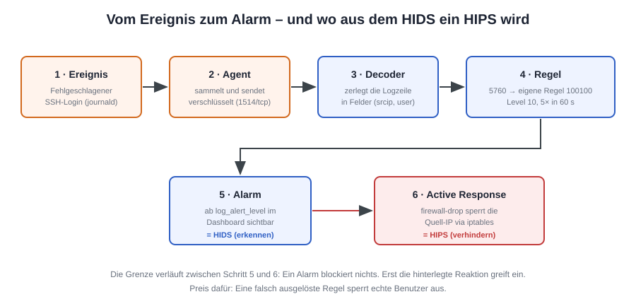

# Monitoring der Endpunkte mit Wazuh

**Auftrag:** Monitoring der Endpunkte mit wazuh
**Kompetenzband:** D – HIDS in Betrieb nehmen
**Bearbeitete Stufe:** A (D1A), umfasst die Stufen B und I
**Verfasser:** Rewan Ezzeldin
**Datum:** 20. September 2026

---

## Inhaltsverzeichnis

1. [Messwerte dieses Setups](#1-messwerte-dieses-setups)
2. [Umgebung und Aufbau](#2-umgebung-und-aufbau)
3. [Installation der zentralen Komponenten](#3-installation-der-zentralen-komponenten)
4. [Installation des Agenten](#4-installation-des-agenten)
5. [Auswertung des Dashboards](#5-auswertung-des-dashboards)
6. [Härtung des überwachten Systems](#6-härtung-des-überwachten-systems)
7. [Begründung der Werkzeugwahl](#7-begründung-der-werkzeugwahl)
8. [Anpassung von Wazuh an die Systemsituation](#8-anpassung-von-wazuh-an-die-systemsituation)
9. [Beurteilung der Grenzen](#9-beurteilung-der-grenzen)
10. [Reflexion](#10-reflexion)
11. [KI-Log](#11-ki-log)
12. [Anhang](#12-anhang)
13. [Fazit](#13-fazit)

---

## 1. Stand der Arbeit

### Abdeckung der geforderten Punkte

| Geforderter Punkt | Kapitel |
|---|---|
| Dokumentation der Installation von Wazuh | 3 (zentrale Komponenten) und 4 (Agent) |
| Dokumentation der Härtungsmassnahmen | 6 |
| Fazit mit eigener Meinung und Lerngewinn | 13 |

### Offene Punkte

Aufbau, Konfiguration und Auswertung sind abgeschlossen und dokumentiert. Offen sind ausschliesslich die Zahlenwerte aus dem zweiten Messdurchgang, die nach Abschluss der Härtungsphase nachgetragen werden:

- SCA-Score und Anzahl fehlgeschlagener Checks vor und nach der Härtung (Kapitel 6.1)
- Anzahl Schwachstellen je Schweregrad (Kapitel 6.4)
- IP-Adresse des überwachten Endpunkts, da die Zuweisung über DHCP erfolgt (Kapitel 2.1)

Die zugehörigen Screenshots werden mit den Werten zusammen ergänzt.

---

## 2. Umgebung und Aufbau

### 2.1 Eingesetzte Systeme

| Rolle | System | Version | IP-Adresse |
|---|---|---|---|
| Host | Windows mit VMware Workstation Pro 17 | 17.5.x | – |
| Zentrale Komponenten | VM «Wazuh-Server», Amazon Linux 2023 | Wazuh 4.14.7 | `192.168.179.129` |
| Überwachter Endpunkt | VM «Ubuntu-Endpunkt» | Ubuntu 24.04.2 Desktop | DHCP aus 192.168.179.0/24 |
| Agent | wazuh-agent, DEB amd64 | 4.14.7 | – |

### 2.2 Begründung der Aufbauentscheide

**Singlenode statt Multinode.** Ein Multinode-Cluster dient der Ausfallsicherheit und der Lastverteilung bei mehreren hundert Agenten. Bei einem einzelnen überwachten Endpunkt bringt das keinen Nutzen und kostet nur Ressourcen, weshalb ich einen Singlenode-Cluster einsetze.

**Vorinstallierte VM statt Docker.** Die OVA liefert Manager, Indexer und Dashboard fertig konfiguriert aus, ohne Zertifikatsgenerierung und ohne Kernel-Tuning. Entscheidender war aber die Netzwerkfrage: Der überwachte Endpunkt liegt ebenfalls als VM in VMware, also stehen beide Maschinen im selben virtuellen Netz und erreichen sich direkt. Bei Docker Desktop unter Windows läge der Server hinter dem WSL2-NAT, wodurch die Verbindung aus einer anderen VM nur über zusätzliche Portweiterleitungen funktioniert hätte.

**Test-VM statt Arbeitsgerät.** Überwacht wird bewusst eine Test-VM. Die Active Response greift aktiv in die Firewall ein und die Härtungsmassnahmen verändern Systemeinstellungen – beides wäre auf einem Geschäftsgerät ohne Absprache nicht zulässig. Der Auftrag lässt diese Variante ausdrücklich zu.

### 2.3 Netzwerkaufbau


Beide VMs hängen am NAT-Netz VMnet8 und stehen damit im selben Subnetz. Ein Bridged-Adapter wäre im Schulnetz unzuverlässig, weil DHCP-Vergabe oder Client-Isolation die Verbindung zwischen den Maschinen verhindern können.

| Port | Protokoll | Zweck |
|---|---|---|
| 1514 | TCP | Agent → Manager: verschlüsselte Übermittlung der Events |
| 1515 | TCP | Agent → Manager: Enrollment, Bezug des Agent-Schlüssels |
| 443 | TCP | Browser → Dashboard |
| 55000 | TCP | Wazuh-Server-API, vom Dashboard genutzt |

### 2.4 Rolle der Komponenten

| Komponente | Aufgabe |
|---|---|
| wazuh-manager | Nimmt die Agent-Daten entgegen, dekodiert sie, gleicht sie gegen das Regelwerk ab und löst Alarme sowie Active Responses aus |
| wazuh-indexer | Speichert und indexiert die Alarme |
| wazuh-dashboard | Web-Oberfläche zur Auswertung |
| wazuh-agent | Dienst auf dem Endpunkt, sammelt Logs, Inventar und Konfigurationsprüfungen |

---

## 3. Installation der zentralen Komponenten

### 3.1 Import der OVA

Verwendet wurde die vorinstallierte virtuelle Maschine `wazuh-4.14.7.ova` von `https://packages.wazuh.com/4.x/vm/`. Der Import erfolgte in VMware Workstation über *Datei → Öffnen*. Die Meldung, die Datei erfülle die OVF-Spezifikation nicht, liess sich mit *Retry* übergehen; sie betrifft nur die strikte Schemaprüfung und hat keine Auswirkung auf den Betrieb.

Der Weg über den *New Virtual Machine Wizard* führt nicht zum Ziel, da dieser eine leere VM ohne Betriebssystem erzeugt.

### 3.2 Angepasste VM-Einstellungen

| Einstellung | Standard der OVA | Gewählter Wert | Begründung |
|---|---|---|---|
| Arbeitsspeicher | 8 GB | 8192 MB (8 GB) | Der Host verfügt über 32 GB, daher konnte der Standardwert unverändert bleiben. Der Indexer ist eine Java-Anwendung und reagiert empfindlich auf knappen Speicher |
| Prozessoren | 4 | 4 | unverändert übernommen |
| Festplatte | 50 GB | 50 GB (IDE) | unverändert übernommen |
| Netzwerkadapter | Bridged | NAT (VMnet8) | siehe Abschnitt 2.3 |
| Diskettenlaufwerk | vorhanden | vorhanden, ohne Funktion | Legacy-Gerät aus dem OVA-Template, wird vom System nicht genutzt |


### 3.3 Erster Start

Die Anmeldung an der Konsole erfolgt mit dem Benutzer `wazuh-user` und dem Passwort `wazuh`. Der SSH-Login als root ist deaktiviert, `wazuh-user` verfügt über sudo-Rechte.

```bash
ip a
```

```
2: eth0: <BROADCAST,MULTICAST,UP,LOWER_UP> mtu 1500 qdisc fq_codel state UP group default qlen 1000
    link/ether 00:0c:29:63:75:1d brd ff:ff:ff:ff:ff:ff
    inet 192.168.179.129/24 metric 1024 brd 192.168.179.255 scope global dynamic eth0
       valid_lft 1323sec preferred_lft 1323sec
```

Die Angabe `valid_lft` zeigt, dass die Adresse vom DHCP des VMnet8 geliehen ist und nach Ablauf neu vergeben werden könnte. Da die Manager-IP fest in der Konfiguration des Agenten hinterlegt wird, habe ich im VMware Virtual Network Editor eine DHCP-Reservierung auf die MAC-Adresse `00:0c:29:63:75:1d` gesetzt. Ohne diesen Schritt verliert der Agent nach einem Neustart die Verbindung zum Server.

Kontrolle der Dienste:

```bash
sudo systemctl status wazuh-manager wazuh-indexer wazuh-dashboard --no-pager
```

Alle drei Dienste meldeten `Active: active (running)`.

### 3.4 Zugang zum Dashboard

Das Dashboard ist unter `https://192.168.179.129` erreichbar. Die Zertifikatswarnung des Browsers ist erwartbar, da die OVA ein selbstsigniertes Zertifikat verwendet.

Der Auftrag nennt als Standardzugang `admin` / `SecretPassword`. Das ist der Default der Docker-Variante; die OVA verwendet `admin` / `admin`. In einer produktiven Umgebung wären beide Zugänge umgehend zu ändern, da sie öffentlich dokumentiert und damit jedem Angreifer bekannt sind. Für die Laborumgebung habe ich bewusst darauf verzichtet und halte den Punkt stattdessen hier fest.


---

## 4. Installation des Agenten

### 4.1 Vorbereitung und Erreichbarkeitsprüfung

Auf der Ubuntu-VM wurde zunächst der SSH-Dienst installiert, um die weitere Arbeit vom Host aus erledigen zu können:

```bash
sudo apt update
sudo apt install -y openssh-server
```

Prüfung der Erreichbarkeit der für Wazuh nötigen Ports:

```bash
ping -c 3 192.168.179.129
nc -zv 192.168.179.129 1514
nc -zv 192.168.179.129 1515
```

```
3 packets transmitted, 3 received, 0% packet loss
Connection to 192.168.179.129 1514 port [tcp/*] succeeded!
Connection to 192.168.179.129 1515 port [tcp/*] succeeded!
```

Diese Prüfung vorab spart Zeit: Ein Agent, der sich nicht verbindet, ist in den allermeisten Fällen kein Wazuh-Problem, sondern eine blockierte Verbindung auf Port 1514 oder 1515.

### 4.2 Registrierung über das Dashboard

Der Agent wurde über *Agents → Deploy new agent* angelegt:

| Feld | Wert |
|---|---|
| Package | DEB amd64 |
| Server address | `192.168.179.129` |
| Agent name | ubuntu-endpunkt |
| Agent group | default |

Ich habe bewusst den vom Dashboard generierten Befehl verwendet und nicht eine Anleitung aus dem Netz. Damit ist sichergestellt, dass die Agent-Version zur Server-Version passt. Der Agent darf gleich alt oder älter sein als die zentralen Komponenten, aber nie neuer: Ein neuerer Manager kommt mit älteren Agenten zurecht, umgekehrt schlägt die Verbindung fehl. In der Praxis bedeutet das, dass bei einem Update immer zuerst der Server und erst danach – zeitversetzt möglich – die Agenten aktualisiert werden.


### 4.3 Installation

```bash
wget https://packages.wazuh.com/4.x/apt/pool/main/w/wazuh-agent/wazuh-agent_4.14.7-1_amd64.deb
sudo WAZUH_MANAGER='192.168.179.129' WAZUH_AGENT_NAME='ubuntu-endpunkt' dpkg -i ./wazuh-agent_4.14.7-1_amd64.deb
sudo systemctl daemon-reload
sudo systemctl enable wazuh-agent
sudo systemctl start wazuh-agent
```

Kontrolle der Verbindung:

```bash
sudo tail -n 20 /var/ossec/logs/ossec.log
```

```
INFO: Requesting a key from server: 192.168.179.129
INFO: Valid key received
INFO: Connected to the server (192.168.179.129:1514/tcp).
```

Der Agent erscheint im Dashboard nach kurzer Zeit mit dem Status *Active*.


### 4.4 Anpassung der Logquelle unter Ubuntu 24.04

Die Standardkonfiguration des Agenten liest Authentifizierungsereignisse aus `/var/log/auth.log`. Ubuntu 24.04 protokolliert jedoch über journald, und diese Datei existiert je nach Installation nicht mehr. Ohne Anpassung kommen deshalb keine SSH-Ereignisse beim Manager an – die eigene Regel aus Abschnitt 8.3 würde nie auslösen, ohne dass ein Fehler sichtbar wäre.

Ergänzung in `/var/ossec/etc/ossec.conf` auf dem Agenten:

```xml
<localfile>
  <log_format>journald</log_format>
  <location>journald</location>
</localfile>
```

```bash
sudo systemctl restart wazuh-agent
```

---

## 5. Auswertung des Dashboards

Untersucht habe ich vor allem die Bereiche ENDPOINT SECURITY und THREAT INTELLIGENCE.

| Modul | Gesammelte Informationen |
|---|---|
| Inventory / Syscollector | Hardwaredaten, Betriebssystemversion, Netzwerkschnittstellen mit IP- und MAC-Adressen, offene Ports mit zugehörigem Prozess, sämtliche installierten Pakete mit Version, laufende Prozesse |
| Configuration Assessment | Abweichungen von den CIS-Benchmarks, je Check mit Beschreibung, Begründung und Behebungsvorschlag |
| Vulnerability Detection | Installierte Software mit bekannten CVEs, nach Schweregrad sortiert |
| File Integrity Monitoring | Änderungen an überwachten Verzeichnissen, standardmässig unter anderem `/etc`, `/usr/bin`, `/usr/sbin` |
| MITRE ATT&CK | Zuordnung der ausgelösten Regeln zu Angriffstechniken |
| Threat Hunting | Durchsuchbare Roh-Events aller Agenten mit Filtermöglichkeit |


**Eigene Einschätzung.** Am auffälligsten ist die Detailtiefe des Inventars. Wazuh kennt nach wenigen Minuten jedes installierte Paket, jeden offenen Port und jeden laufenden Prozess des Endpunkts. Das ist für die Sicherheit äusserst nützlich, macht aber zugleich deutlich, welche Verantwortung mit einem solchen System einhergeht: Wer Zugriff auf das Dashboard hat, sieht sehr genau, was auf den überwachten Geräten geschieht. In einem Unternehmen wäre deshalb zu regeln, wer diesen Zugriff erhält, und bei Mitarbeitergeräten wären Mitwirkungsrechte der Belegschaft zu berücksichtigen.

Der zweite Punkt betrifft die Menge: Bereits ein einzelner Agent erzeugt im Leerlauf laufend Events. Hochgerechnet auf mehrere hundert Endpunkte wird schnell klar, warum die Alarmschwelle aus Abschnitt 8.2 keine Nebensächlichkeit ist, sondern darüber entscheidet, ob das System im Alltag brauchbar bleibt.

---

## 6. Härtung des überwachten Systems

Vor allen Änderungen habe ich in VMware einen Snapshot der Ubuntu-VM erstellt, um jede Massnahme zurücknehmen zu können.

### 6.1 Ergebnis des Configuration Assessment

| Kennzahl | Vor der Härtung | Nach der Härtung |
|---|---|---|
| Score in Prozent | wird nachgetragen | wird nachgetragen |
| Failed Checks | wird nachgetragen | wird nachgetragen |


### 6.2 Kritische Prüfung der Empfehlungen

Ein Score von 100 Prozent war ausdrücklich nicht mein Ziel. Die CIS-Benchmarks sind für gehärtete Serversysteme geschrieben; auf einem Desktop-System ist ein Teil der Empfehlungen schlicht unpassend. Entscheidend ist, dass jeder Befund einmal bewertet wurde – entweder umgesetzt oder begründet verworfen. Ein unbewerteter Befund ist das eigentliche Risiko, weil niemand weiss, ob dahinter eine echte Lücke steckt.

| CIS-Check | Entscheid | Begründung |
|---|---|---|
| Nicht benötigte Kernelmodule (cramfs, udf) deaktivieren | umgesetzt | Diese Dateisysteme werden auf dem System nicht verwendet. Die Angriffsfläche sinkt ohne jeden Funktionsverlust |
| Display Manager entfernen | verworfen | Es handelt sich um ein Desktop-System; ohne grafische Oberfläche wäre es für den vorgesehenen Zweck unbrauchbar. Die Empfehlung stammt aus dem Server-Benchmark |
| auditd installieren und aktivieren | umgesetzt | Liefert zusätzliche, für Wazuh auswertbare Ereignisse und verbessert damit die Erkennung |
| Root-Login über SSH unterbinden | umgesetzt | Root ist der offensichtlichste Angriffspunkt für Brute-Force. Administrative Arbeiten erfolgen über sudo, die Funktionalität bleibt erhalten |
| Automatische Updates aktivieren | umgesetzt | Adressiert direkt die Befunde aus der Vulnerability Detection |
| Strikte Firewall-Standardregel (deny all) | verworfen | In der Laborumgebung muss der Agent den Manager erreichen und der Test der Active Response nachvollziehbar bleiben. Auf einem produktiven System wäre die Empfehlung umzusetzen |

Der Auftrag nennt als Beispiel für einen irrelevanten Befund die Windows-Registry: Wazuh meldet dort unsichere Einstellungen zu Features, die gar nicht aktiviert sind – die Empfehlung ist so lange bedeutungslos, bis das Feature eingeschaltet wird. Das Gegenstück unter Ubuntu sind Checks zu Diensten, die auf dem System gar nicht installiert sind, sowie Serveranforderungen auf einem Desktop-System. Beide Muster sind mir bei der Durchsicht begegnet.

### 6.3 Umgesetzte Massnahmen

Deaktivierung nicht benötigter Kernelmodule:

```bash
echo "install cramfs /bin/false" | sudo tee /etc/modprobe.d/cramfs.conf
echo "blacklist cramfs" | sudo tee -a /etc/modprobe.d/cramfs.conf
```

Härtung des SSH-Dienstes:

```bash
sudo sed -i 's/^#\?PermitRootLogin.*/PermitRootLogin no/' /etc/ssh/sshd_config
sudo sed -i 's/^#\?MaxAuthTries.*/MaxAuthTries 4/' /etc/ssh/sshd_config
sudo sshd -t && sudo systemctl restart ssh
```

Der Aufruf `sshd -t` prüft die Konfigurationsdatei vor dem Neustart auf Syntaxfehler und gibt bei korrekter Syntax nichts aus. Ohne diese Prüfung riskiert man einen Dienst, der nach dem Neustart nicht mehr hochkommt.

Anpassung von Kernelparametern:

```bash
echo "net.ipv4.conf.all.accept_redirects = 0" | sudo tee /etc/sysctl.d/60-hardening.conf
sudo sysctl --system
```

Anschliessend wurde der Agent neu gestartet, was einen erneuten SCA-Scan auslöst:

```bash
sudo systemctl restart wazuh-agent
```


### 6.4 Auswertung der Vulnerability Detection

| Schweregrad | Anzahl |
|---|---|
| Critical | wird nachgetragen |
| High | wird nachgetragen |
| Medium | wird nachgetragen |

Die Liste zeigt installierte Pakete mit bekannten Schwachstellen, sortiert nach Kritikalität, was eine unmittelbare Priorisierung erlaubt. Der überwiegende Teil der Befunde liess sich durch das Einspielen der verfügbaren Sicherheitsupdates beheben:

```bash
sudo apt update && sudo apt upgrade -y
sudo systemctl restart wazuh-agent
```

Bis der neue Inventarstand indexiert ist und die Liste entsprechend schrumpft, vergehen einige Minuten. Dass überhaupt verwundbare Versionen gefunden wurden, obwohl das System frisch installiert ist, zeigt den eigentlichen Wert dieses Moduls: Zwischen Installationsmedium und aktuellem Patchstand liegt immer eine Lücke, und ohne systematische Prüfung merkt das niemand.


---

## 7. Begründung der Werkzeugwahl

**Szenario:** Zu überwachen ist der öffentlich erreichbare Webserver eines Unternehmens.

### 7.1 Warum Wazuh

Ein öffentlich erreichbarer Webserver wird permanent und automatisiert angegriffen. Entscheidend ist nicht ein einzelner Aspekt der Überwachung, sondern deren Kombination auf dem Host selbst:

| Anforderung | Leistung von Wazuh |
|---|---|
| Wer meldet sich an, wer scheitert dabei? | Log-Analyse mit mitgeliefertem Regelwerk für SSH, Apache, Nginx und sudo |
| Wurden Dateien im Webroot verändert, etwa durch eine Webshell? | File Integrity Monitoring |
| Läuft verwundbare Software auf dem Server? | Vulnerability Detection gegen CVE-Feeds |
| Entspricht die Konfiguration den Vorgaben? | Configuration Assessment mit CIS-Benchmarks |
| Lässt sich alles zentral auswerten und aufbewahren? | Indexer und Dashboard, nachvollziehbar für Audits |
| Kann automatisch reagiert werden? | Active Response |

Wazuh deckt diese Punkte in einem einzigen Werkzeug ab und hält die Ergebnisse zentral vor. Die Alternativen decken jeweils nur einen Ausschnitt ab.

### 7.2 Abgrenzung zu den Alternativen

| Tool | Leistung | Warum hier nicht ausreichend |
|---|---|---|
| Fail2Ban | Sperrt IP-Adressen nach fehlgeschlagenen Anmeldungen | Reagiert ausschliesslich auf Logmuster. Keine Integritätsprüfung, keine Schwachstellenerkennung, keine zentrale Auswertung über mehrere Systeme |
| Suricata | NIDS/NIPS, analysiert den Netzwerkverkehr | Sieht den Verkehr, nicht das Geschehen auf dem Host. Bei TLS-verschlüsseltem Datenverkehr ohne Aufbruch stark eingeschränkt – und der Verkehr zu einem Webserver ist heute praktisch vollständig verschlüsselt |
| Velociraptor | DFIR-Werkzeug für gezieltes Hunting und Forensik | Auf die Untersuchung eines konkreten Verdachtsfalls ausgelegt, nicht auf Dauerbetrieb mit laufender Alarmierung |
| Zabbix | Verfügbarkeits- und Performance-Monitoring | Beantwortet die Frage «läuft der Dienst?», nicht die Frage «wurde er kompromittiert?» |

### 7.3 Situationen, in denen ein anderes Werkzeug besser passt

**Suricata.** Soll ein Netzsegment mit Druckern, Kameras und IoT-Geräten überwacht werden, scheidet Wazuh aus: Auf diesen Geräten lässt sich kein Agent installieren. Suricata hängt stattdessen am Spiegelport des Switches und sieht den Verkehr aller Geräte, ohne dass auf ihnen etwas installiert werden muss.

**Zabbix.** Geht es um die Zusicherung von Verfügbarkeiten gegenüber einem Kunden – Antwortzeiten, Speicherplatz, Ausfälle samt Trendauswertung – ist Zabbix das passende Werkzeug. Sicherheit und Verfügbarkeit sind unterschiedliche Fragestellungen und verlangen unterschiedliche Instrumente.

---

## 8. Anpassung von Wazuh an die Systemsituation

Die Standardkonfiguration passt nie exakt auf das zu überwachende System. Folgende vier Anpassungen habe ich vorgenommen.

### 8.1 Zuweisung der passenden SCA-Policy

Wazuh liefert für jedes Betriebssystem eigene Policies mit:

```bash
ls -l /var/ossec/ruleset/sca/
```

Die aktive Policy ist im Dashboard unter *Configuration Assessment* ersichtlich. Um die Zuordnung nicht der automatischen Betriebssystemerkennung zu überlassen, habe ich sie in `/var/ossec/etc/ossec.conf` auf dem Agenten explizit gesetzt:

```xml
<sca>
  <enabled>yes</enabled>
  <scan_on_start>yes</scan_on_start>
  <interval>12h</interval>
  <policies>
    <policy>/var/ossec/ruleset/sca/cis_ubuntu24-04.yml</policy>
  </policies>
</sca>
```

**Begründung:** Eine Policy für die falsche Distribution oder Version prüft Pfade und Dienste, die auf diesem System gar nicht existieren. Das erzeugt zweifachen Schaden: Fehlalarme, die Zeit kosten, und gleichzeitig übersehene echte Abweichungen, weil die zutreffenden Checks nie ausgeführt werden.

### 8.2 Festlegung der Alarmschwelle

Wazuh bewertet jede Regel mit einem Level zwischen 0 und 16. Die Schwelle wird auf dem Manager in `/var/ossec/etc/ossec.conf` gesetzt:

```xml
<alerts>
  <log_alert_level>3</log_alert_level>
  <email_alert_level>12</email_alert_level>
</alerts>
```

**Begründung der Wahl.** Level 3 als Schwelle für das Dashboard behält auch erfolgreiche Anmeldungen und Systemereignisse im Blick. Das ist in dieser Umgebung sinnvoll, weil ich die Regelkette nachvollziehen können muss und das Datenvolumen bei einem einzigen Agenten unkritisch ist. Die Benachrichtigungsschwelle habe ich deutlich höher auf Level 12 belassen, damit nur handlungsbedürftige Ereignisse jemanden aktiv unterbrechen würden.

**Zu tiefe Schwelle.** Es entstehen so viele Alarme, dass die wichtigen darin untergehen. Das Team gewöhnt sich an ständige Meldungen und schaut irgendwann nicht mehr hin – Alarmmüdigkeit. Zusätzlich wächst der Indexer schnell, was Speicher und Suchgeschwindigkeit belastet.

**Zu hohe Schwelle.** Frühe Anzeichen eines Angriffs – einzelne fehlgeschlagene Anmeldungen, Konfigurationsänderungen, neu installierte Software – erzeugen gar keinen Alarm mehr. Gemeldet wird erst, wenn der Schaden bereits eingetreten ist. Genau die Zeitspanne, in der man einen Angriff noch abwenden könnte, bleibt dann unbeobachtet.

### 8.3 Eigene Regel

Die Regel liegt auf dem Manager in `/var/ossec/etc/rules/local_rules.xml`:

```xml
<group name="local,syslog,sshd,">

  <rule id="100100" level="10" frequency="5" timeframe="60" ignore="60">
    <if_matched_sid>5760</if_matched_sid>
    <same_source_ip />
    <description>Mehrfach fehlgeschlagene SSH-Anmeldungen von derselben IP ($(srcip)) innerhalb einer Minute</description>
    <group>authentication_failures,</group>
    <mitre>
      <id>T1110</id>
    </mitre>
  </rule>

</group>
```

| Element | Bedeutung und Begründung |
|---|---|
| `id="100100"` | Der Bereich ab 100000 ist für eigene Regeln reserviert und wird bei Updates des Regelwerks nicht überschrieben |
| `level="10"` | Liegt über der Alarmschwelle und entspricht der Wazuh-Klassifikation für mehrfache Authentifizierungsfehler |
| `frequency` und `timeframe` | Korrelation statt Einzelereignis: Ein fehlgeschlagener Login ist ein Tippfehler, fünf in einer Minute sind ein Muster |
| `if_matched_sid="5760"` | Baut auf der mitgelieferten Regel für fehlgeschlagene SSH-Passwörter auf, statt das Logformat selbst zu parsen. Das ist robuster gegenüber Formatänderungen |
| `same_source_ip` | Zählt pro Quell-IP. Ohne diese Angabe würden Fehlversuche verschiedener Benutzer aus dem gesamten Netz zusammenaddiert, was zu Fehlalarmen führt |
| `ignore="60"` | Unterdrückt Wiederholungsalarme für 60 Sekunden, damit ein einzelner Angriff nicht hunderte identische Meldungen erzeugt |

Nach dem Eintragen wurde der Manager neu gestartet und das Log geprüft, da ein Syntaxfehler in `local_rules.xml` den Start des Managers verhindert:

```bash
sudo systemctl restart wazuh-manager
sudo tail -n 20 /var/ossec/logs/ossec.log
```

**Test der Regel.** Mit `wazuh-logtest` lässt sich eine Logzeile gegen das Regelwerk prüfen, ohne ein echtes Ereignis auszulösen:

```bash
sudo /var/ossec/bin/wazuh-logtest
```

Eingabe einer typischen Logzeile:

```
Sep 20 14:22:31 ubuntu-endpunkt sshd[2345]: Failed password for rewan from 192.168.179.129 port 51234 ssh2
```

Die erste Eingabe trifft die Basisregel 5760 mit Level 5. Erst bei mehrfacher Eingabe derselben Zeile springt die Regel-ID auf 100100 und das Level auf 10.

**Auslösen unter realen Bedingungen.** Den Angriff habe ich bewusst von der Wazuh-Server-VM aus gestartet und nicht über die Verbindung, mit der ich selbst auf dem System arbeite – andernfalls hätte mich die Active Response aus Abschnitt 8.4 aus meiner eigenen Sitzung ausgesperrt:

```bash
for i in $(seq 1 6); do ssh rewan@<UBUNTU_IP> -o PreferredAuthentications=password -o PubkeyAuthentication=no; done
```

Kontrolle auf dem Manager:

```bash
sudo grep 100100 /var/ossec/logs/alerts/alerts.log
```


**Beobachtung beim Test.** Die Regel löste nicht beim fünften, sondern erst beim sechsten Anmeldeversuch aus. Der Grund: `frequency` zählt in Wazuh die Treffer zusätzlich zum auslösenden ersten Ereignis. Wer die Schwelle exakt auf einen Wert setzen will, muss das einrechnen. Diese Abweichung zwischen erwartetem und tatsächlichem Verhalten ist beim blossen Lesen der Dokumentation nicht erkennbar und zeigt, warum eine Regel erst nach dem praktischen Test als fertig gelten kann.

### 8.4 Active Response

Ergänzung in `/var/ossec/etc/ossec.conf` auf dem Manager. Der zugehörige `<command>`-Block für `firewall-drop` ist bereits in der Standardkonfiguration enthalten:

```xml
<active-response>
  <disabled>no</disabled>
  <command>firewall-drop</command>
  <location>local</location>
  <rules_id>100100</rules_id>
  <timeout>180</timeout>
</active-response>
```

| Parameter | Begründung |
|---|---|
| `command` | Mitgeliefertes Skript, das die Quell-IP über iptables blockiert |
| `location: local` | Ausführung nur auf dem Agenten, auf dem das Ereignis auftrat. `all` würde die IP auf sämtlichen Agenten sperren – bei einem Fehlalarm ein netzweiter Ausfall |
| `rules_id` | Reaktion ausschliesslich auf die eigene Regel 100100, nicht auf beliebige Alarme |
| `timeout` | Die Sperre wird nach 180 Sekunden automatisch aufgehoben. Eine dauerhafte Sperre würde sich bei Fehlauslösungen mit der Zeit zu einer unübersichtlichen Blockliste auswachsen |

Kontrolle auf der Ubuntu-VM nach dem Auslösen:

```bash
sudo iptables -L INPUT -n --line-numbers
sudo tail -n 20 /var/ossec/logs/active-responses.log
```

```
Chain INPUT (policy ACCEPT)
num  target     prot opt source               destination
1    DROP       all  --  192.168.179.129           0.0.0.0/0
```

Nach Ablauf des Timeouts erscheint im Log ein zweiter Eintrag mit `"command":"delete"` und die iptables-Regel verschwindet wieder. Manuell lässt sich eine Sperre mit `sudo iptables -D INPUT -s <IP> -j DROP` aufheben.


### 8.5 Übergang vom HIDS zum HIPS



Bis und mit dem Alarm arbeitet Wazuh als **HIDS**: Es sammelt Ereignisse auf dem Host, erkennt Muster und meldet sie. Der Alarm selbst verhindert nichts – der Angreifer kann unverändert weiterarbeiten, solange niemand reagiert.

Mit der Active Response wird daraus ein **HIPS**: Das System greift selbsttätig ein und sperrt die Quell-IP auf dem betroffenen Endpunkt. Genau an dieser Stelle – zwischen Alarm und Reaktion – verläuft die Grenze zwischen Erkennung und Prävention.

Der Preis dafür ist ein neues Risiko. Jede Fehlauslösung sperrt nun echte Benutzer aus. Bei einer Regel auf fehlgeschlagene Anmeldungen genügt ein Mitarbeiter, der sein Passwort mehrfach falsch eingibt. Steht hinter der Quell-IP ein NAT-Gateway, trifft die Sperre sogar einen ganzen Standort. Ein HIPS ist damit keine bessere Version eines HIDS, sondern ein Tausch: mehr Schutz gegen mehr Betriebsrisiko.

---

## 9. Beurteilung der Grenzen

Ebenso wichtig wie die Frage, was Wazuh leistet, ist die Frage, was es in diesem konkreten Setup nicht sieht. Wer die Grenzen eines Werkzeugs nicht kennt, wiegt sich in falscher Sicherheit – und das ist gefährlicher als gar kein Monitoring, weil dann niemand mehr nach weiteren Massnahmen fragt.

### Grenze 1: Nur Geräte mit Agent sind überwachte Geräte

In diesem Setup ist genau ein Endpunkt überwacht. Der Windows-Host, auf dem beide VMs laufen, ist es nicht – obwohl eine Kompromittierung des Hosts sämtliche VMs mitnimmt. Wazuh weiss ausschliesslich von Systemen, auf denen ein Agent läuft. Übertragen auf ein Unternehmen betrifft das private Geräte, Drucker, IoT-Hardware und vor allem Schatten-IT, von der die IT-Abteilung nichts weiss und für die sie folglich auch keinen Agenten ausrollen kann.

### Grenze 2: Hostbasiert statt netzwerkbasiert

Der Agent sieht ausschliesslich, was auf der Ubuntu-VM selbst geschieht. Der Verkehr im VMnet8-Segment bleibt ihm verborgen. Ein SYN-Scan gegen die VM erzeugt kein Ereignis, weil kein Dienst ihn protokolliert. Angriffe, die sich zwischen den Systemen abspielen, fallen vollständig aus dem Blickfeld.

### Grenze 3: Erkennen ist nicht verhindern

Die Active Response greift erst, nachdem die Regel ausgelöst hat – also nach sechs Fehlversuchen plus Verarbeitungszeit. Ein Angreifer mit gültigen Zugangsdaten aus einem Phishing-Angriff löst überhaupt nichts aus: Er meldet sich beim ersten Versuch erfolgreich an, und für Wazuh ist das eine gewöhnliche Anmeldung.

Für die Reflexion verwende ich die Grenzen 1 und 2, da sie in diesem Aufbau am unmittelbarsten zutreffen.

---

## 10. Reflexion

### 10.1 Zwei Grenzen mit konkretem Angriffsszenario

**Grenze 1 – nur Geräte mit Agent werden überwacht.**
Der Windows-Host trägt keinen Agenten. Über einen manipulierten Download fängt sich der Benutzer dort einen Infostealer ein. Die Schadsoftware liest gespeicherte SSH-Schlüssel und Browser-Sitzungen aus und greift damit auf die Ubuntu-VM zu – mit gültigem Schlüssel, über eine reguläre Sitzung. Im Dashboard erscheint eine erfolgreiche Anmeldung, die von einer legitimen nicht zu unterscheiden ist. Der eigentliche Angriff fand auf einem System statt, von dem Wazuh nichts weiss, und der sichtbare Teil sieht vollkommen normal aus. Das ist der gefährlichste Fall: nicht ein übersehener Alarm, sondern gar kein Alarm.

**Grenze 2 – hostbasiert statt netzwerkbasiert.**
Ein Angreifer im selben Netzsegment führt ARP-Spoofing durch und leitet den Verkehr zwischen der Ubuntu-VM und dem Wazuh-Server über seine eigene Maschine. Beide Systeme funktionieren unverändert weiter, auf beiden geschieht nichts Protokollierbares. Ein NIDS wie Suricata würde die gefälschten ARP-Antworten sofort erkennen; der hostbasierte Agent sieht nichts, weil auf dem Host nichts Auffälliges passiert. Besonders heikel ist dabei, dass der Angreifer damit auch den Weg kontrolliert, über den die Alarme zum Server gelangen.

### 10.2 Zwei Zusatzmassnahmen

**Technisch: Multi-Faktor-Authentifizierung für SSH**

*Geschlossene Lücke:* Grenze 1. Gestohlene Zugangsdaten oder Schlüssel allein genügen nicht mehr für eine Anmeldung.

*Erwartete Wirkung:* Ein Angreifer mit korrekten Zugangsdaten scheitert am zweiten Faktor. Zusätzlich entsteht ein neues, auswertbares Signal: Eine fehlgeschlagene MFA-Prüfung bei gleichzeitig korrektem Passwort ist ein deutlicher Hinweis auf kompromittierte Zugangsdaten. Darauf lässt sich wiederum eine Wazuh-Regel aufbauen – die Massnahme verbessert also nicht nur die Prävention, sondern auch die Erkennung.

*Neue Nachteile und Risiken:* Einrichtungs- und Betriebsaufwand, ein Prozess für verlorene oder defekte Token wird zwingend nötig. Ohne diesen Prozess sperrt man im Ernstfall die eigenen Leute aus. Dazu kommt Widerstand bei Benutzern, die den zusätzlichen Schritt als Schikane empfinden.

**Organisatorisch: Sensibilisierung mit Phishing-Simulation**

*Geschlossene Lücke:* Ebenfalls Grenze 1, allerdings an der Wurzel: Der Angriff wird verhindert, bevor überhaupt Zugangsdaten abfliessen.

*Erwartete Wirkung:* Messbar sinkende Klickraten, vor allem aber gemeldete Vorfälle. Ein Mitarbeiter, der eine verdächtige Mail meldet, liefert eine Frühwarnung, die kein Agent erzeugen kann – er erkennt den Angriff in einer Phase, in der technisch noch gar nichts passiert ist.

*Neue Nachteile und Risiken:* Wiederkehrender Zeitaufwand für alle Beteiligten, Kosten für die Plattform. Das grösste Risiko ist kultureller Art: Werden die Simulationen als Falle statt als Übung wahrgenommen, meldet am Ende niemand mehr etwas, aus Angst, sich zu blamieren. Damit bewirkt die Massnahme das Gegenteil des Beabsichtigten. Schulung wirkt zudem nie vollständig – sie senkt die Wahrscheinlichkeit, beseitigt das Risiko aber nicht.

### 10.3 Warum zusätzliche Tools das Problem nie allein lösen

Jedes Werkzeug hat einen definierten Blickwinkel: Wazuh sieht den Host, Suricata das Netz, MFA schützt die Anmeldung, Schulung adressiert den Menschen. Kein einzelnes Werkzeug deckt alle Ebenen ab, und jedes lässt sich umgehen, sobald es allein steht.

**Defense-in-Depth** beantwortet genau das mit gestaffelten, voneinander unabhängigen Schichten: Fällt eine aus, greift die nächste. Der Angreifer muss sämtliche Schichten überwinden, der Verteidiger muss nur an einer Stelle erfolgreich sein. Deshalb ist die Frage nach den Grenzen eines Werkzeugs wichtiger als die nach seinem Funktionsumfang – nur wer die Lücke kennt, kann sie mit einer anderen Schicht schliessen.

Dazu kommt ein Punkt, der beim Stapeln von Werkzeugen leicht vergessen geht: Jede zusätzliche Schicht bringt eigene Kosten, eigene Fehlerquellen und eigene Angriffsfläche mit. Ein zusätzliches System ist selbst wieder ein System, das gepatcht, konfiguriert und überwacht werden muss. Mehr Tools bedeuten deshalb nicht automatisch mehr Sicherheit. Entscheidend ist, dass die Schichten bewusst gewählt sind, sich ergänzen statt sich zu überlappen – und dass jemand die Alarme tatsächlich auswertet. Ein Monitoring, das niemand anschaut, erzeugt nur ein Sicherheitsgefühl, und das ist schlechter als gar keines.

### 10.4 Erkenntnisse aus dem KI-Einsatz

Siehe Kapitel 11.

---

## 11. KI-Log

| Wofür eingesetzt | Vorschlag | Entscheid | Begründung |
|---|---|---|---|
| Aufbau der Regel 100100 | Korrelationsregel auf Basis von `if_matched_sid` statt eigenem Decoder | übernommen | Robuster gegenüber Änderungen des Logformats als ein selbst geschriebener Ausdruck |
| Review der Regel | Ergänzung von `same_source_ip` | übernommen | Ohne diese Angabe werden Fehlversuche verschiedener Quellen zusammengezählt, was einen Fehlalarm erzeugt, sobald mehrere Benutzer gleichzeitig arbeiten |
| Review der Regel | Höheres Level, damit die Regel sicher auffällt | verworfen | Level 10 entspricht der Wazuh-Klassifikation für mehrfache Authentifizierungsfehler. Ein künstlich erhöhtes Level verzerrt die Priorisierung im Verhältnis zu allen anderen Regeln |
| Active Response | `location: all` für netzweite Sperrung | verworfen | Bei einem Fehlalarm wäre die Quell-IP auf allen Agenten gesperrt. Das Risiko steht in keinem Verhältnis zum Nutzen in dieser Umgebung |
| Active Response | Sperre ohne Timeout | verworfen | Fehlauslösungen würden sich dauerhaft ansammeln und die Blockliste unwartbar machen |

**Erkenntnis zur Reflexionsfrage 4.** Den wichtigsten Punkt hat weder der eigene Entwurf noch das Review aufgedeckt, sondern erst der praktische Test: dass `frequency` erst beim Ereignis nach der angegebenen Anzahl auslöst (siehe Abschnitt 8.3). Eine Regel gilt damit erst dann als fertig, wenn sie unter realen Bedingungen ausgelöst und das Ergebnis überprüft wurde.

---

## 12. Anhang

### 12.1 Aufgetretene Probleme und Lösungen

| Symptom | Ursache | Lösung |
|---|---|---|
| `wazuh-indexer` meldet nach dem ersten Start `failed (Result: timeout)`, Manager und Dashboard bleiben `inactive (dead)` | Der Indexer überschreitet beim Start das systemd-Zeitlimit. Manager und Dashboard sind von ihm abhängig und starten deshalb gar nicht erst. Ressourcen waren nicht die Ursache (8 GB RAM, 37 GB frei, 4 Kerne) | Diagnose über `/var/log/wazuh-indexer/`, da der Dienst nicht ins systemd-Journal schreibt. Prüfung von `vm.max_map_count` (Minimum 262144) und der Heap-Werte in `/etc/wazuh-indexer/jvm.options`. Bei langsamem Datenträger Startzeitfenster mit `systemctl edit wazuh-indexer` und `TimeoutStartSec=900` erhöhen |
| VM startet nicht, Meldung «The guest operating system has disabled the CPU» | AMD-Prozessor in Kombination mit VMware | `.vmx`-Datei um die cpuid-Zeilen und `featureCompat.enable = "FALSE"` ergänzen |
| Agent bleibt auf *Never connected* | Ports 1514/1515 blockiert oder falsche Manager-IP | Prüfung mit `nc -zv 192.168.179.129 1514` und `grep -A3 '<client>' /var/ossec/etc/ossec.conf` |
| Agent wird nach IP-Wechsel *Disconnected* | DHCP hat dem Server eine neue Adresse zugewiesen | Manager-IP in der `ossec.conf` des Agenten korrigieren und Agent neu starten |
| Manager startet nach Regeländerung nicht | Syntaxfehler in `local_rules.xml` | `sudo /var/ossec/bin/wazuh-logtest -t` und Auswertung von `/var/ossec/logs/ossec.log` |
| Keine SSH-Events im Dashboard | Ubuntu 24.04 protokolliert über journald statt in `/var/log/auth.log` | journald-`localfile` ergänzen, siehe Abschnitt 4.4 |
| Regel löst später aus als erwartet | `frequency` zählt ab dem zweiten Ereignis | Ein Ereignis mehr erzeugen als angegeben |
| Eigene Verbindung nach AR-Test unterbrochen | Selbstsperrung durch firewall-drop | Über die VMware-Konsole: `sudo iptables -D INPUT -s <IP> -j DROP` |

### 12.2 Wichtige Pfade

| Pfad | Inhalt |
|---|---|
| `/var/ossec/etc/ossec.conf` | Hauptkonfiguration von Manager und Agent |
| `/var/ossec/etc/rules/local_rules.xml` | Eigene Regeln auf dem Manager |
| `/var/ossec/ruleset/sca/` | Mitgelieferte SCA-Policies |
| `/var/ossec/logs/ossec.log` | Betriebslog von Agent und Manager |
| `/var/ossec/logs/alerts/alerts.log` | Ausgelöste Alarme auf dem Manager |
| `/var/ossec/logs/active-responses.log` | Protokoll der Active Responses auf dem Agenten |

### 12.3 Befehlsübersicht

```bash
# Status der Komponenten
sudo systemctl status wazuh-manager --no-pager
sudo systemctl status wazuh-agent --no-pager
sudo /var/ossec/bin/wazuh-control status

# Agenten auflisten (auf dem Manager)
sudo /var/ossec/bin/agent_control -l

# Regeln testen
sudo /var/ossec/bin/wazuh-logtest
sudo /var/ossec/bin/wazuh-logtest -t

# Logs verfolgen
sudo tail -f /var/ossec/logs/ossec.log
sudo tail -f /var/ossec/logs/alerts/alerts.log
```

### 12.4 Quellen

- Wazuh-Dokumentation, Virtual Machine (OVA): `https://documentation.wazuh.com/current/deployment-options/virtual-machine/virtual-machine.html`
- Wazuh-Dokumentation, Agent Enrollment Requirements: `https://documentation.wazuh.com/current/user-manual/agent/agent-enrollment/requirements.html`
- Wazuh-Dokumentation, Architektur: `https://documentation.wazuh.com/current/getting-started/architecture.html`
- Wazuh-Dokumentation, Active Response: `https://documentation.wazuh.com/current/user-manual/capabilities/active-response/index.html`
- Unterrichtsunterlagen: Theorie Monitoring, Theorie Hardening

---

## 13. Fazit

### Was Wazuh in diesem Aufbau geleistet hat

Am meisten beeindruckt hat mich, wie schnell aus einem unbeobachteten System ein transparentes wird. Wenige Minuten nach der Verbindung des Agenten kannte das Dashboard jedes installierte Paket, jeden offenen Port und jede Abweichung von den CIS-Benchmarks. Diese Transparenz ist der eigentliche Wert des Werkzeugs: Nicht die Alarme sind das Entscheidende, sondern dass man überhaupt erst weiss, in welchem Zustand die eigenen Systeme sind. Vor diesem Auftrag hätte ich nicht sagen können, welche verwundbaren Paketversionen auf einem frisch installierten Ubuntu laufen – und genau das ist das Problem, das Wazuh löst.

Ebenso überzeugend fand ich, dass mehrere Fragestellungen in einem Werkzeug zusammenlaufen. Logauswertung, Integritätsprüfung, Schwachstellen- und Konfigurationsmanagement wären sonst vier getrennte Systeme mit vier Oberflächen. Dass sich all das zentral auswerten lässt, ist der Grund, warum Wazuh für einen öffentlich erreichbaren Server die richtige Wahl ist.

### Kritische Punkte

Der Betrieb ist anspruchsvoller, als die Marketingdarstellung vermuten lässt. Schon der erste Start der OVA brachte ein Problem: Der Indexer lief in einen Timeout, und weil Manager und Dashboard von ihm abhängen, stand das gesamte System still, ohne dass eine aussagekräftige Fehlermeldung erschien. Das systemd-Journal war leer, die eigentliche Ursache steckte in einem separaten Logverzeichnis. Wer Wazuh produktiv betreiben will, braucht solides Linux-Wissen – mit der reinen Klickbedienung im Dashboard kommt man nicht weit.

Eine zweite Erkenntnis betrifft die Standardkonfiguration: Sie passt nie. Unter Ubuntu 24.04 liest der Agent per Default eine Logdatei, die es nicht mehr gibt, weil das System über journald protokolliert. Ohne Anpassung hätte ich einen scheinbar funktionierenden Aufbau gehabt, bei dem SSH-Ereignisse schlicht nie ankommen. Genau das halte ich für die gefährlichste Fehlerart überhaupt: nicht der Fehler, der auffällt, sondern der, der wie Normalbetrieb aussieht.

Dazu kommt der Aufwand für die Nachbearbeitung. Ein grosser Teil der CIS-Befunde war für ein Desktop-System nicht relevant. Diese Bewertung kann kein Werkzeug abnehmen – sie setzt voraus, dass man das eigene System und seinen Verwendungszweck kennt. Ein Score von 100 Prozent ist deshalb kein sinnvolles Ziel.

### Was ich gelernt habe

Fachlich war der grösste Gewinn das Verständnis der Kette vom Ereignis über den Decoder und die Regel bis zum Alarm. Vorher war ein SIEM für mich eine Blackbox, die irgendwie Warnungen produziert. Nachdem ich eine eigene Regel geschrieben, getestet und dabei festgestellt habe, dass `frequency` anders zählt als erwartet, ist daraus ein nachvollziehbarer Ablauf geworden. Die Erkenntnis dahinter gilt allgemein: Eine Regel ist erst fertig, wenn sie unter realen Bedingungen ausgelöst und überprüft wurde. Eine Konfiguration, die plausibel aussieht, aber nie getestet wurde, ist wertlos.

Konzeptionell hat mich die Arbeit an den Grenzen des Werkzeugs am meisten weitergebracht. Der Übergang vom HIDS zum HIPS klang zunächst nach einer reinen Verbesserung – bis klar wurde, dass ich mir mit der Active Response ein neues Betriebsrisiko einhandle: Jede Fehlauslösung sperrt echte Benutzer aus. Sicherheitsmassnahmen sind selten kostenlos, sie sind fast immer ein Tausch. Diese Abwägung bewusst zu treffen und zu begründen, halte ich für den wichtigsten Teil dieses Auftrags.

Zuletzt hat sich mein Blick auf das eigene Setup verändert. Ich überwache genau einen Endpunkt, während der Host, auf dem alles läuft, keinen Agenten trägt. Ein Monitoring, dem man blind vertraut, ist gefährlicher als gar keines, weil es ein Sicherheitsgefühl erzeugt, das weitere Massnahmen verhindert. Deshalb gehört für mich zu jedem eingesetzten Werkzeug künftig die Frage dazu, was es gerade nicht sieht.
